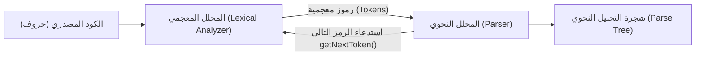
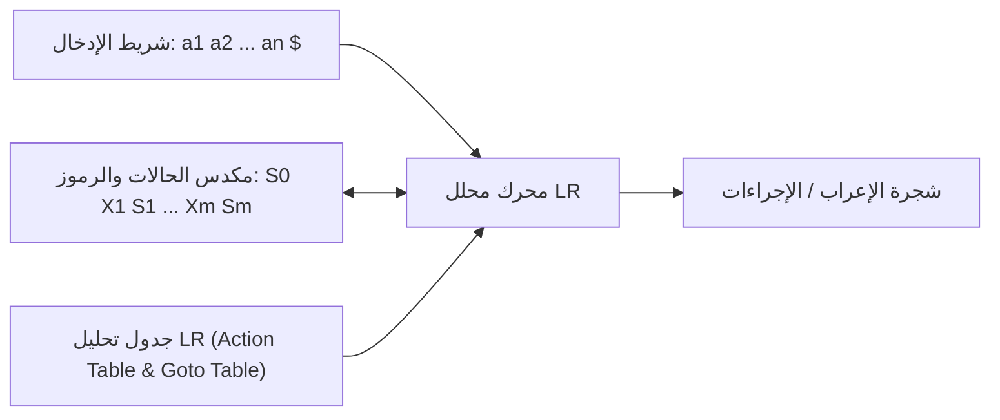
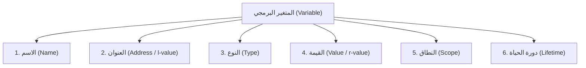
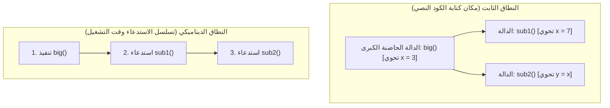
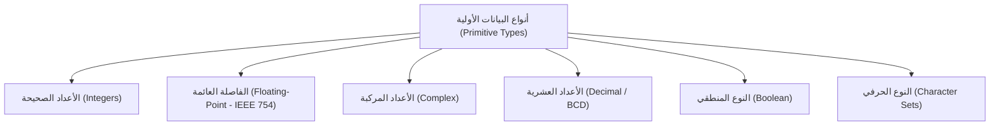

# CS336: Concepts of Programming Languages
## الملخص الأكاديمي الشامل والمتكامل للمقرر الدراسي
**إعداد وتدقيق:** أستاذ المادة والخبير الأكاديمي في لغات البرمجة وتصميم المناهج  
**الكتاب المرجعي المعتمد للمقرر:** *Concepts of Programming Languages*, 12th Edition, by Robert W. Sebesta (Pearson, 2018/2019)  
**نطاق التغطية:** الفصول من الأول إلى الخامس، والجزء الأول المتاح من الفصل السادس (سلايدات المحاضرات الرسمية المعتمدة)  
**حالة التدقيق:** تمت مراجعة كافة الشرائح الأصلية، وتحليل الأكواد والمسائل، وتصحيح الأخطاء العلمية والطباعية الواردة في السلايدات  

---

## مقدمة عامة ونطاق الملخص الدراسي

يهدف هذا الدليل الأكاديمي الشامل إلى تزويد طالب علوم الحاسب الآلي بمرجع علمي دقيق ومتكامل لمقرر **مفاهيم لغات البرمجة (CS336 - Concepts of Programming Languages)**. لا يقتصر هذا الملخص على سرد التعريفات والقوانين بصورة مجردة، بل يشرح الفلسفة الرياضية والبرمجية العميقة الكامنة خلف تصميم لغات البرمجة، وتطورها التاريخي، ونظريات بنائها وصياغتها (Syntax)، وتحديد دلالاتها ومعانيها (Semantics)، وآليات ترجمتها وتنفيذها (Lexical & Syntax Analysis)، بالإضافة إلى دراسة المتغيرات وأنظمة الربط والنطاقات (Names, Bindings, and Scopes)، وأنواع البيانات الأولية وواصفاتها (Data Types).

### المصادر المعتمدة ونطاق المراجعة:
تم إعداد هذا الملخص استنادًا إلى الفحص الاستقصائي المتعمق لملفات العروض التقديمية الأصلية المعتمدة داخل مجلد المقرر `CS336`:
1. `pl12ch1.ppt`: الفصل الأول - تمهيدات ومفاهيم لغات البرمجة (34 شريحة).
2. `pl12ch2.ppt`: الفصل الثاني - التطور التاريخي لسلالات لغات البرمجة (65 شريحة).
3. `pl12ch3 Describing Syntax and Semantics.ppt`: الفصل الثالث - وصف الصياغة والدلالات النحوية والرياضية (57 شريحة).
4. `pl12ch4 Lexical and Syntax Analysis.ppt`: الفصل الرابع - التحليل المعجمي والنحوي النظري والتطبيقي (46 شريحة).
5. `pl12ch5 Names and Bindings and Scopes.ppt`: الفصل الخامس - الأسماء، والربط، ودورة الحياة، والنطاقات (44 شريحة).
6. `pl12ch6 part I Data Types.ppt`: الفصل السادس (الجزء الأول) - أنواع البيانات الأولية، السلاسل الحرفية، التعداد، ومقدمة المصفوفات (25 شريحة).

> [!IMPORTANT]
> **تنبيه أكاديمي حول حدود المنهج:** يتوقف المحتوى الفعلي المتاح في ملفات المجلد عند نهاية الشريحة رقم (25) من ملف الفصل السادس (`pl12ch6 part I Data Types.ppt`) والتي تنتهي عند موضوع "المصفوفات الثابتة Static Arrays". وبناءً على الأمانة العلمية والتزامًا بالمواد التعليمية المرفوعة فعليًا، لا يتضمن هذا الملخص موضوعات الجزء الثاني من الفصل السادس (مثل باقي فئات المصفوفات، والسجلات Records، والمؤشرات Pointers) أو الفصول من السابع فما بعد، مع التنويه عنها في ختام الملخص.

---

## فهرس المحتويات الشامل

1. [الفصل الأول: تمهيدات ومفاهيم لغات البرمجة (Preliminaries)](#الفصل-الأول-تمهيدات-ومفاهيم-لغات-البرمجة-preliminaries)
   * 1.1 دوافع دراسة مفاهيم لغات البرمجة
   * 1.2 مجالات ونطاقات البرمجة (Programming Domains)
   * 1.3 معايير تقييم لغات البرمجة (Language Evaluation Criteria)
   * 1.4 المؤثرات على تصميم لغات البرمجة (معمارية فون نيومان ومنهجيات البرمجة)
   * 1.5 فئات وأنماط لغات البرمجة (Language Categories / Paradigms)
   * 1.6 تحديات المفاضلة في التصميم (Design Trade-offs)
   * 1.7 أساليب ونظم تنفيذ لغات البرمجة (Implementation Methods)
   * 1.8 المعالجات الأولية وبيئات التطوير (Preprocessors & Environments)
   * 1.9 مراجعة الفصل الأول للامتحان ومسائل تدريبية محلولة (Exam Review & Practice)
2. [الفصل الثاني: التطور التاريخي وسلالات لغات البرمجة (Evolution of Major Programming Languages)](#الفصل-الثاني-التطور-التاريخي-وسلالات-لغات-البرمجة-evolution-of-major-programming-languages)
   * 2.1 بدايات لغات البرمجة: Plankalkül والأكواد الزائفة الأولية
   * 2.2 الحوسبة العلمية وظهور لغة Fortran وتطور إصداراتها
   * 2.3 البرمجة الوظيفية وظهور لغة Lisp وتطبيقات الذكاء الاصطناعي
   * 2.4 لغة ALGOL 60 وأثرها المفصلي في تاريخ لغات البرمجة
   * 2.5 حوسبة الأعمال ولغة COBOL ودور وزارة الدفاع الأمريكية (DoD)
   * 2.6 لغات المشاركة الزمنية والأنظمة المتكاملة: BASIC و PL/I
   * 2.7 اللغات الديناميكية والتجريد الأولي: APL و SNOBOL و SIMULA 67
   * 2.8 لغة التناسب والتعامدية: ALGOL 68 ولغة Pascal
   * 2.9 لغة C وبرمجة النظم ولغة المنطق Prolog
   * 2.10 ملحمة تصميم لغة Ada وتطورها (Ada 83 إلى Ada 95)
   * 2.11 ثورة البرمجة كائنية التوجه (OOP): Smalltalk و C++ و Java و C#
   * 2.12 لغات البرمجة النصية للويب (Scripting Languages) واللغات الهجينة
   * 2.13 الخط الزمني ومخطط سلالات اللغات (Genealogy & Timeline)
   * 2.14 مراجعة الفصل الثاني للامتحان ومسائل تدريبية محلولة (Exam Review & Practice)
3. [الفصل الثالث: وصف البنية والدلالات (Describing Syntax and Semantics)](#الفصل-الثالث-وصف-البنية-والدلالات-describing-syntax-and-semantics)
   * 3.1 الصياغة النحوية مقابل الدلالات (Syntax vs. Semantics)
   * 3.2 القواعد النحوية الخالية من السياق (Context-Free Grammars - CFG)
   * 3.3 صيغة باكوس-ناور (BNF) وصيغة باكوس-ناور الموسعة (EBNF)
   * 3.4 الاشتقاقات (Derivations) وصيغ الجمل وأشجار التحليل (Parse Trees)
   * 3.5 غموض القواعد النحوية (Ambiguity) وآليات فرضه وحله (Precedence & Associativity)
   * 3.6 الدلالات الثابتة وقواعد السمات (Attribute Grammars)
   * 3.7 الدلالات الديناميكية: الدلالات التشغيلية (Operational Semantics)
   * 3.8 الدلالات الديناميكية: الدلالات التعيينية (Denotational Semantics)
   * 3.9 الدلالات الديناميكية: الدلالات البديهية ومنطق هوار (Axiomatic Semantics & Hoare Logic)
   * 3.10 حساب الشروط المسبقة الأضعف (Weakest Preconditions - wp) وثوابت الحلقات (Loop Invariants)
   * 3.11 مراجعة الفصل الثالث للامتحان ومسائل تدريبية محلولة بالخطوات (Exam Review & Practice)
4. [الفصل الرابع: التحليل المعجمي والنحوي (Lexical and Syntax Analysis)](#الفصل-الرابع-التحليل-المعجمي-والنحوي-lexical-and-syntax-analysis)
   * 4.1 مقدمة التحليل وتبرير فصل المحلل المعجمي عن المحلل النحوي
   * 4.2 المحلل المعجمي ومخططات الحالة (State Diagrams & DFA)
   * 4.3 التحليل البرمجي لكود المحلل المعجمي بلغة C (برنامج front.c)
   * 4.4 مشكلة الإعراب وتصنيف المحللات (Top-Down vs. Bottom-Up)
   * 4.5 التحليل الهابط العودي (Recursive-Descent Parsing) والتطبيق البرمجي
   * 4.6 مشكلة التكرار اليساري (Left Recursion) وخوارزمية إزالته الرياضية
   * 4.7 اختبار تباعد الثنائيات (Pairwise Disjointness Test) ومجموعات FIRST
   * 4.8 التحليل النحوي التصاعدي (Bottom-Up LR Parsing) والمقابض (Handles)
   * 4.9 بنية محللات LR وجداول العمليات والانتقال (Action & Goto Tables)
   * 4.10 مراجعة الفصل الرابع للامتحان ومسائل تدريبية محلولة (Exam Review & Practice)
5. [الفصل الخامس: الأسماء، والربط، والنطاقات (Names, Bindings, and Scopes)](#الفصل-الخامس-الأسماء-والربط-والنطاقات-names-bindings-and-scopes)
   * 5.1 الأسماء والمعرفات (Names & Identifiers) وقضايا التصميم
   * 5.2 سمات المتغيرات الست (The Six Attributes of Variables)
   * 5.3 مفهوم الربط (Binding) وتصنيف أوقات الربط (Binding Times)
   * 5.4 ربط الأنواع والتصريح الصريح والضمني والديناميكي
   * 5.5 أصناف المتغيرات الأربعة حسب دورة الحياة (Lifetime Categories)
   * 5.6 النطاق الثابت (Static Scope) والكتل البرمجية وتراكيب LET
   * 5.7 النطاق الديناميكي (Dynamic Scope) وتسلسل الاستدعاءات
   * 5.8 مسألة تتبع النطاق الكلاسيكية (Scope Resolution Tracing)
   * 5.9 بيئات الإسناد (Referencing Environments) والثوابت المسماة (Named Constants)
   * 5.10 مراجعة الفصل الخامس للامتحان ومسائل تدريبية محلولة (Exam Review & Practice)
6. [الفصل السادس: أنواع البيانات - الجزء الأول (Data Types — Part I)](#الفصل-السادس-أنواع-البيانات---الجزء-الأول-data-types--part-i)
   * 6.1 مفهوم نوع البيانات وواصفات المتغيرات (Descriptors)
   * 6.2 أنواع البيانات الأولية: الأعداد الصحيحة (Integers) وتمثيل المتمم الثنائي
   * 6.3 الأعداد ذات الفاصلة العائمة (Floating-Point) ومعيار IEEE 754
   * 6.4 الأعداد المركبة (Complex) والأعداد العشرية المشفرة ثنائيًا (Decimal / BCD)
   * 6.5 الأنواع المنطقية (Boolean) والأنواع الحرفية (Character Sets)
   * 6.6 أنواع السلاسل الحرفية (Character Strings): خيارات الطول، العمليات، والواصفات
   * 6.7 الأنواع الترتيبية والتعدادية المعرفة من المستخدم (Enumeration Types)
   * 6.8 مقدمة المصفوفات (Array Types): قضايا التصميم، الفهرسة، والمصفوفات الثابتة (Static Arrays)
   * 6.9 حدود الجزء الأول والموضوعات غير المتاحة من الفصل السادس
   * 6.10 مراجعة الفصل السادس للامتحان ومسائل تدريبية محلولة (Exam Review & Practice)
7. [سجل التدقيق العلمي وتصحيح أخطاء السلايدات الأصلية (Scientific Auditing & Corrections)](#سجل-التدقيق-العلمي-وتصحيح-أخطاء-السلايدات-الأصلية-scientific-auditing--corrections)
8. [المراجعة النهائية الشاملة وجداول المقارنة المركزية (Final Comprehensive Revision)](#المراجعة-النهائية-الشاملة-وجداول-المقارنة-المركزية-final-comprehensive-revision)

---


## الفصل الأول: تمهيدات ومفاهيم لغات البرمجة (Preliminaries)

### 1.1 دوافع دراسة مفاهيم لغات البرمجة (Reasons for Studying Concepts of Programming Languages)
إن دراسة لغات البرمجة في المستوى الجامعي لا تهدف إلى مجرد تعلم صياغة (Syntax) لغة جديدة، بل تهدف إلى بناء وعي تحليلي ومعماري عميق بكيفية عمل اللغات واختيارها وتقييمها. يحدد المقرر ستة دوافع جوهرية:

1. **زيادة القدرة على التعبير عن الأفكار البرمجية (Increased ability to express ideas):**
   * تؤثر اللغة التي يفكر بها المبرمج في طبيعة الحلول التي يستطيع تصورها. فالمبرمج الذي لا يعرف سوى التراكيب الأساسية للغات التقليدية قد يعجز عن حل مشكلات تتطلب معالجات مصفوفية متوازنة أو معالجة رموز غير عددية.
   * إدراك المفاهيم المتقدمة (مثل الاستدعاء الذاتي Recursion، والبرمجة الوظيفية Higher-Order Functions، وتراكيب التحكم غير المتزامنة) يمكّن المبرمج من محاكاة وتطبيق هذه الأفكار حتى في اللغات التي تفتقر إلى دعم صريح لها.
2. **تحسين الخلفية لاختيار اللغات المناسبة للمشاريع (Improved background for choosing appropriate languages):**
   * كثير من المبرمجين يلجؤون لاستخدام اللغة التي يتقنونها في كافة المشاريع حتى لو كانت غير ملائمة. دراسة المقرر تمنح المطور معايير موضوعية للموازنة بين اللغات واختيار الأداة المثلى بحسب بيئة المشكلة (مثل تفضيل C لنظم التشغيل، وPython للتحليل السريع، وCOBOL للتقارير المحاسبية).
3. **زيادة القدرة على تعلم لغات جديدة بسرعة (Increased ability to learn new languages):**
   * تتشابه لغات البرمجة في مفاهيمها الأساسية (نظم الربط، إدارة الذاكرة، وقواعد النطاق). عند فهم هذه المبادئ العامة، يصبح تعلم لغة جديدة مجرد استيعاب لصياغة جديدة (Syntax) لنفس المفاهيم المألوفة، مما يقلل زمن اكتساب المهارة.
4. **فهم أفضل لأهمية التنفيذ وتكلفة التراكيب (Better understanding of significance of implementation):**
   * عند إدراك كيف يترجم الحاسوب المتغيرات والاستدعاءات الحلقية والفرعية، يستطيع المبرمج كتابة أكواد أكثر كفاءة، وتجنب التراكيب التي تسبب عبئًا غير مرئي على الذاكرة أو المعالج (مثل تكلفة تكرار تخصيص الذاكرة الحرة في الكائنات).
5. **استخدام أفضل للغات البرمجة المعروفة بالفعل (Better use of languages that are already known):**
   * تساعد دراسة لغات البرمجة على اكتشاف إمكانيات مجهولة في اللغات التي يستخدمها المطور يوميًا، وتفسير سلوكيات غامضة (مثل سلوك المؤشرات، والتحويل التلقائي للأنواع Type Coercion).
6. **المساهمة في التقدم العام لمجال الحوسبة (Overall advancement of computing):**
   * يساعد فهم معايير جودة اللغات على ترجيح كفة اللغات الأفضل تصميمًا بدلًا من الانسياق وراء اللغات التي تكتسب شعبية لمجرد دعم شركات معينة لها على الرغم من عيوبها التصميمية.

---

### 1.2 مجالات ونطاقات البرمجة (Programming Domains)
تطورت لغات البرمجة في مسارات مختلفة لتلبي متطلبات مجالات تطبيقية متباينة:

| نطاق البرمجة (Domain) | الخصائص الحوسبية واحتياجات البيانات | أمثلة اللغات الرائدة |
|---|---|---|
| **التطبيقات العلمية (Scientific Applications)** | حسابات معقدة بأرقام الفاصلة العائمة (Floating-point)، استخدام مكثف للمصفوفات، والحاجة للسرعة القصوى. | **Fortran** (أول لغة عالية المستوى مصممة لهذا الغرض عام 1957). |
| **تطبيقات الأعمال (Business Applications)** | إنتاج التقارير المالية والإدارية المعقدة، العمليات الحسابية العشرية الدقيقة دون تقريب، والتعامل مع السجلات والبيانات الحرفية. | **COBOL** (تمتاز بالتراكيب الوصفية باللغة الإنجليزية وعمليات الأرقام العشرية المشفرة BCD). |
| **الذكاء الاصطناعي (Artificial Intelligence)** | معالجة الرموز والأسماء بدلًا من الأرقام، الاعتماد المكثف على القوائم المترابطة (Linked Lists)، والقدرة على تعديل الكود ديناميكيًا. | **Lisp** (لغة وظيفية تعتمد القوائم)، و **Prolog** (لغة منطقية تعتمد الحقائق والقواعد). |
| **برمجة النظم (Systems Programming)** | برمجيات تعمل باستمرار وبتماس مباشر مع العتاد (نظم التشغيل، برامج التعريف، برامج الشبكات)، تتطلب كفاءة تنفيذية مطلقة وتحكمًا دقيقًا في الذاكرة. | **C** (صممت خصيصًا لتطوير نظام UNIX بمرونة وقوة تحاكي لغة التجميع). |
| **برمجيات الويب (Web Software)** | خليط غير متجانس يجمع بين لغات التوصيف (مثل HTML/XML)، ولغات البرمجة النصية لمعالجة النماذج (مثل PHP و JavaScript)، واللغات العامة لتطبيقات الخوادم (مثل Java). | **JavaScript** (جانب العميل)، و **PHP / Python** (جانب الخادم). |

---

### 1.3 معايير تقييم لغات البرمجة (Language Evaluation Criteria)
حدد روبرت سيبستا أربعة معايير تقييم أساسية تنبثق منها مجموعة من العوامل التصميمية الفرعية:

```mermaid
graph TD
    Criteria["معايير تقييم لغات البرمجة الأساسية"]
    Criteria --> R["1. قابلية القراءة (Readability)"]
    Criteria --> W["2. قابلية الكتابة (Writability)"]
    Criteria --> Rel["3. الموثوقية (Reliability)"]
    Criteria --> C["4. التكلفة الإجمالية (Cost)"]
    
    R --> R1["البساطة العامة (Overall Simplicity)"]
    R --> R2["التعامدية (Orthogonality)"]
    R --> R3["أنواع البيانات (Data Types)"]
    R --> R4["تصميم الصياغة (Syntax Considerations)"]
    
    W --> W1["البساطة والتعامدية"]
    W --> W2["دعم التجريد (Support for Abstraction)"]
    W --> W3["القدرة التعبيرية (Expressivity)"]
    
    Rel --> Rel1["فحص النوع (Type Checking)"]
    Rel --> Rel2["معالجة الاستثناءات (Exception Handling)"]
    Rel --> Rel3["تجنب الأسماء البديلة (Aliasing)"]
    Rel --> Rel4["قابلية القراءة والكتابة"]
    
    C --> C1["تكلفة تدريب المبرمجين"]
    C --> C2["تكلفة كتابة وترجمة البرامج"]
    C --> C3["تكلفة تنفيذ البرامج وصيانتها"]
```



#### المعايير الفرعية بالتفصيل:

1. **قابلية القراءة (Readability):**
   * **البساطة العامة (Overall Simplicity):**
     * *تجنب تعدد الميزات (Feature Multiplicity):* وجود أكثر من طريقة لتنفيذ نفس العملية يؤدي إلى إرباك القارئ. مثال: في لغة C/Java، يمكن زيادة العداد بطرق متعددة: `count = count + 1` أو `count += 1` أو `count++` أو `++count`.
     * *الحد من التحميل الزائد للعمليات (Minimal Operator Overloading):* استخدام نفس الرمز لمعانٍ متعددة يربك القراءة إن لم يكن بديهيًا. استخدام `+` للجمع ولدمج النصوص مقبول، لكن إعادة تعريفه لعمليات غير رياضية يقلل القراءة.
   * **التعامدية (Orthogonality):**
     * تعني أن مجموعة صغيرة نسبيًا من التراكيب الأولية يمكن دمجها بعدد قليل من القواعد المتسقة، بحيث يكون كل تركيب ناتج قانونيًا ومقبولًا نحويًا دون وجود استثناءات خاصة.
     * *مثال على غياب التعامدية:* في لغة C، يمكن تمرير الأرقام والهياكل (structs) كمعاملات بالدوال وإعادتها كقيمة عائدة، لكن المصفوفات لا يمكن إعادتها كقيمة مباشرة من الدالة ولا يمكن نسخها مباشرة بجملة الإسناد `arr1 = arr2`، مما يمثل استثناءً شاذًا يحد من التعامدية.
   * **كفاية أنواع البيانات (Adequate Data Types):**
     * وجود أنواع بيانات كافية يرفع القراءة؛ مثل وجود نوع منطقي صريح `boolean` يمنع استخدام الأرقام `0` و `1` كما في إصدارات C القديمة، مما يجعل الشروط مثل `if (flag == true)` أكثر وضوحًا من `if (flag == 1)`.
   * **اعتبارات الصياغة (Syntax Considerations):**
     * *أشكال المعرفات (Identifier forms):* مرونة التسمية، والسماح بالأطوال الكافية، والكلمات المركبة (مثل `camelCase` أو `snake_case`).
     * *الكلمات الخاصة (Special Words):* وضوح بدايات ونهايات الكتل البرمجية، واستخدام كلمات دالة (مثل `if ... end if` في Ada بدلاً من مجرد أقواس متطابقة).
     * *الصياغة والمعنى (Form and Meaning):* يجب أن يوحي شكل التركيب بوظيفته المنطقية.

2. **قابلية الكتابة (Writability):**
   * **دعم التجريد (Support for Abstraction):** القدرة على تعريف واستخدام بنيات بيانات أو عمليات معقدة مع إخفاء تفاصيلها الداخلية. ينقسم إلى:
     * *تجريد العمليات (Process Abstraction):* مثل الدوال والبرامج الفرعية التي تستدعى كصندوق أسود (Black Box).
     * *تجريد البيانات (Data Abstraction):* مثل الفئات (Classes) وهياكل البيانات المجردة (ADT) التي تخفي تفاصيل التخزين وتتيح التفاعل عبر واجهة محددة.
   * **القدرة التعبيرية (Expressivity):** توافر تراكيب قوية ومريحة لإجراء العمليات الحسابية والمنطقية دون الحاجة لكتابة كود مطول؛ مثل حلقة `for (item : collection)` في Java و Python بدلاً من التحكم اليدوي بالفهارس.

3. **الموثوقية (Reliability):**
   * **فحص النوع (Type Checking):** اختبار تطابق الأنواع واكتشاف الأخطاء؛ ويكون أكثر موثوقية وقت الترجمة (Compile-time) مقارنة بوقت التشغيل (Run-time).
   * **معالجة الاستثناءات (Exception Handling):** قدرة البرنامج على اعتراض أخطاء التشغيل (مثل القسمة على صفر أو نقص الذاكرة) واتخاذ تدابير استباقية لمنع الانهيار المفاجئ.
   * **ظاهرة الأسماء البديلة (Aliasing):** وجود وسيلتين أو أكثر للإشارة إلى نفس الموقع في الذاكرة (مثل المؤشرات المتقاطعة). التعديل عبر أحدهما يغير قيمة الآخر بصمت، مما يمثل خطرًا جسيمًا على الموثوقية.

4. **التكلفة (Cost):**
   * تشمل تكلفة تدريب المبرمجين (مرتبطة بالبساطة والتعامدية)، تكلفة كتابة الكود (مرتبطة بقابلية الكتابة)، تكلفة الترجمة، تكلفة التنفيذ (السرعة واستهلاك الموارد)، تكلفة معالجة الأخطاء الضعيفة الموثوقية، والتكلفة الأكبر على الإطلاق: **تكلفة صيانة البرمجيات وتعديلها (Maintenance Cost)**.

5. **معايير إضافية (Other Criteria):**
   * **قابلية النقل (Portability):** سهولة تشغيل البرامج على منصات وعمائر حاسوبية مختلفة دون تعديل (تعتمد على وجود مواصفة قياسية صارمة للغة، مثل استقلالية Java عبر JVM).
   * **العمومية (Generality):** قابلية تطبيق اللغة على طيف عريض من المجالات بدلاً من حصرها في تطبيق متخصص وحيد.
   * **وضوح ودقة التعريف (Well-definedness):** اكتمال ودقة التوثيق الرسمي المنشور للغة ومواصفاتها القياسية.

---

### 1.4 المؤثرات على تصميم لغات البرمجة (Influences on Language Design)

#### 1. تأثير معمارية الحاسب: بنية فون نيومان (The von Neumann Architecture)
أثرت بنية العتاد الصلب للحواسيب بشكل جوهري على تصميم لغات البرمجة. فمنذ خمسينيات القرن الماضي وحتى اليوم، تعتمد الحواسيب الرقمية على معمارية **فون نيومان (von Neumann Architecture)**.

* **مكونات المعمارية:**
  1. وحدة الذاكرة الرئيسية (Memory): تخزن البرامج والبيانات معًا.
  2. وحدة المعالجة المركزية (CPU): منفصلة ماديًا عن الذاكرة، وتحوي وحدة الحساب والمنطق (ALU)، والسجلات (Registers)، وعداد البرنامج (Program Counter - PC).
  3. ممر نقل البيانات (Bus): ينقل التعليمات والبيانات ذهابًا وإيابًا بين الذاكرة والـ CPU.
* **كيف انبثقت اللغات الإجرائية من معمارية فون نيومان؟**
  * **المتغيرات (Variables):** صممت لتمثل تجريدًا مباشرًا لخلايا الذاكرة الفعلية.
  * **جمل الإسناد (Assignment Statements):** صممت لتمثل عمليات ضخ ونقل البيانات بين الذاكرة والمعالج.
  * **التكرار والحلقات (Iteration / Loops):** تعتبر وسيلة فعالة للغاية على مستوى العتاد لأنها تستغل إعادة تنفيذ كتل تعليمات قريبة في الذاكرة باستخدام قفزات بسيطة في عداد البرنامج (PC).

#### دورة جلب وتنفيذ التعليمات (Fetch-Execute Cycle):
تعمل حواسيب فون نيومان عبر حلقة تكرارية مستمرة على مستوى العتاد:

```text
initialize the program counter (تهيئة عداد البرنامج لعنوان البداية)
repeat forever:
    fetch the instruction pointed to by the counter (جلب التعليمة الموجه إليها بالعداد)
    increment the counter (زيادة العداد ليشير للتعليمة التالية)
    decode the instruction (فك ترميز التعليمة في وحدة التحكم)
    execute the instruction (تنفيذ التعليمة بواسطة وحدة الحساب والمنطق)
end repeat
```

#### عنق زجاجة فون نيومان (Von Neumann Bottleneck):
* سرعة نقل البيانات بين الذاكرة والمعالج عبر الممر (Bus) أبطأ بكثير من سرعة تنفيذ المعالج للتعليمات داخليًا.
* يُعرف هذا التفاوت بـ **عنق زجاجة فون نيومان (Von Neumann Bottleneck)**، وهو العامل الحاسم والمحدد الأساسي لسرعة الحواسيب الإجمالية، ودفع مصممي اللغات للبحث عن تراكيب تقلل من حركة المرور المتكررة بين الذاكرة والمعالج.

#### 2. تأثير منهجيات تطوير البرمجيات (Software Development Methodologies)
* **الخمسينيات وأوائل الستينيات:** ركزت التطبيقات على البساطة الحسابية، وكان الشاغل الأكبر هو **كفاءة الآلة (Machine Efficiency)** بسبب محدودية العتاد.
* **أواخر الستينيات:** أصبحت تكلفة المبرمجين وصيانة الكود أعلى من تكلفة العتاد، فبرزت أهمية **كفاءة العنصر البشري (People Efficiency)**؛ وظهرت البرمجة المهيكلة (Structured Programming)، والتصميم من الأعلى إلى الأسفل (Top-down design)، وتفكيك المشكلات عبر الخطوات المتتالية (Step-wise refinement).
* **أواخر السبعينيات:** تحول التركيز من التصميم القائم على الإجراءات والعمليات إلى **التصميم القائم على البيانات (Data-oriented design)**، مما أدى لظهور **تجريد البيانات (Data Abstraction)**.
* **منتصف الثمانينيات:** نضوج **البرمجة كائنية التوجه (Object-Oriented Programming - OOP)** القائمة على ثلاثة أركان رئيسية:
  $$\text{OOP} = \text{Data Abstraction (تجريد البيانات)} + \text{Inheritance (الوراثة)} + \text{Polymorphism (تعدد الأشكال)}$$

---

### 1.5 فئات لغات البرمجة (Language Categories / Paradigms)

1. **اللغات الإجرائية / الأمرية (Imperative Languages):**
   * تقوم على المتغيرات وتغيير حالات الذاكرة عبر جمل الإسناد المتتابعة، وتتضمن تراكيب التكرار.
   * تشمل اللغات الإجرائية التقليدية (C, Pascal, Fortran)، واللغات الكائنية (C++, Java, C#)، واللغات المرئية (Visual Basic .NET)، ولغات البرمجة النصية (Perl, Python, JavaScript).
2. **اللغات الوظيفية (Functional Languages):**
   * تعتمد على الحساب الرياضي بتطبيق الدوال الرياضية على المعاملات دون تغيير حالة البرنامج العامة أو استخدام المتغيرات القابلة للتعديل.
   * أمثلة: Lisp, Scheme, ML, F#, Haskell.
3. **اللغات المنطقية (Logic Languages):**
   * لغات تصريحية مبنية على القواعد المنطقية (Rule-based) دون تحديد ترتيب زمني صارم للخطوات، ويقوم الحاسوب بالاستنتاج والبحث عن الحل.
   * أمثلة: Prolog.
4. **اللغات الهجينة بين الترميز والبرمجة (Markup/Programming Hybrid Languages):**
   * أصلها لغات توصيف مظهرية (Markup) تم توسيعها لتضمين تراكيب برمجية (شروط، حلقات، معالجة بيانات).
   * أمثلة: XSLT (لتحويل وثائق XML)، JSTL (لمعالجة بيانات صفحات الويب JSP).

---

### 1.6 تحديات المفاضلة في تصميم اللغات (Language Design Trade-Offs)
لا توجد لغة برمجة مثالية في كل شيء؛ فتصميم اللغات سلسلة مستمرة من المفاضلات والتنازلات (Trade-offs):

1. **الموثوقية مقابل تكلفة التنفيذ (Reliability vs. Cost of Execution):**
   * *مثال:* تفرض لغة **Java** فحص حدود المصفوفات (Array Bounds Checking) عند كل وصول لعنصر في المصفوفة لمنع الاختراق أو انهيار الذاكرة (مما يمنحها موثوقية عالية)، ولكن ذلك يكلف وقت تنفيذ إضافي للمعالج عند كل قراءة أو كتابة. في المقابل، تهمل لغة **C** هذا الفحص لضمان السرعة القصوى على حساب الموثوقية.
2. **قابلية القراءة مقابل قابلية الكتابة (Readability vs. Writability):**
   * *مثال:* توفر لغة **APL** عددًا هائلًا من العمليات والرموز القوية، مما يسمح بكتابة خوارزميات مصفوفية بالغة التعقيد في سطر واحد مضغوط (قابلية كتابة استثنائية)، ولكن قراءة هذا السطر وفهمه لاحقًا يكون بالغ الصعوبة حتى على كاتب الكود نفسه (قابلية قراءة متدنية جدًا).
3. **المرونة وقابلية الكتابة مقابل الموثوقية (Writability vs. Reliability):**
   * *مثال:* تتيح لغة **C++** استخدام المؤشرات الحرة وعمليات الحساب عليها (Pointer Arithmetic)، مما يمنح المبرمج مرونة فائقة وقدرة تحكم عالية بالذاكرة، ولكنه يفتح الباب لأخطر ثغرات الذاكرة البرمجية (Dangling Pointers & Memory Corruption)، مما يضعف الموثوقية.

---

### 1.7 أساليب ونظم تنفيذ لغات البرمجة (Implementation Methods)

تتحول البرامج المكتوبة بلغات عالية المستوى إلى التنفيذ الفعلي عبر أحد الأساليب الثلاثة الرئيسية:

```mermaid
graph TD
    subgraph Compilation["1. الترجمة الكاملة (Compilation)"]
        Src1["الكود المصدري"] --> Trans1["المترجم (Compiler)"]
        Trans1 --> Obj1["كود الآلة الهدف"]
        Obj1 --> Linker["الرابط والمحمل (Linker & Loader)"]
        Linker --> Exec1["الصورة التنفيذية (Load Module)"]
        Exec1 --> Run1["تنفيذ مباشر وسريع على المعالج"]
    end
    
    subgraph Interpretation["2. التفسير البحت (Pure Interpretation)"]
        Src2["الكود المصدري"] --> Interp["المفسر (Interpreter)"]
        Input2["المدخلات"] --> Interp
        Interp --> Out2["المخرجات خطوة بخطوة"]
    end
    
    subgraph Hybrid["3. النظم الهجينة و JIT (Hybrid & JIT)"]
        Src3["الكود المصدري"] --> Trans3["مترجم وسيط"]
        Trans3 --> Bytecode["الشيفرة البايتية (Bytecode)"]
        Bytecode --> VM["الآلة الافتراضية (VM / JIT Compiler)"]
        VM --> Out3["تنفيذ آمن ومحمول"]
    end
```



#### جدول المقارنة الشامل بين أساليب التنفيذ:

| المعيار | الترجمة الكاملة (Compilation) | التفسير البحت (Pure Interpretation) | الأنظمة الهجينة (Hybrid Systems) |
|---|---|---|---|
| **آلية العمل** | ترجمة كامل الكود المصدري دفعة واحدة إلى كود الآلة المستهدف. | قراءة وتحليل وتنفيذ أسطر الكود سطرًا بسطر بواسطة برنامج وسيط (مفسر). | ترجمة الكود إلى لغة وسيطة منخفضة المستوى (Bytecode)، ثم تفسيرها أو تجميعها عبر آلة افتراضية. |
| **سرعة الترجمة** | بطيئة (تمر بمراحل متعددة لتحسين الكود). | لا توجد مرحلة ترجمة مسبقة (بدء فوري). | متوسطة (توليد الشيفرة البايتية سريع). |
| **سرعة التنفيذ** | سريعة جدًا ومباشرة على عتاد المعالج. | بطيئة جدًا (أبطأ من 10 إلى 100 مرة من البرامج المترجمة). | أسرع بكثير من التفسير البحت، وتقترب من المترجم الكامل مع تقنية JIT. |
| **اكتشاف الأخطاء وتصحيحها** | يتم فحص الأخطاء التركيبية قبل التشغيل، وتصحيح أخطاء التشغيل أصعب. | سهل جدًا؛ تظهر أخطاء التشغيل فورًا عند السطر المسبب للخطأ. | متوازن؛ فحص مسبق في مرحلة البايت كود وحماية وقت التشغيل في الآلة الافتراضية. |
| **استهلاك الذاكرة** | صغير نسبيًا (ملف تنفيذي مستقل). | كبير؛ يتطلب وجود المفسر وجداول الرموز في الذاكرة باستمرار. | متوسط؛ يتطلب بيئة تشغيل الآلة الافتراضية (Runtime Engine). |
| **أبرز الأمثلة** | C, C++, Fortran, Ada, Pascal. | الإصدارات الأولية من JavaScript و PHP و APL. | Java (JVM), C# وجميع لغات .NET (CLR), Perl. |

#### مراحل عملية الترجمة الكاملة (Phases of Compilation):
1. **التحليل المعجمي (Lexical Analysis):** يقسم حروف البرنامج المصدري إلى وحدات معجمية تسمى (Lexemes) ويحدد تصنيفها (Tokens).
2. **التحليل النحوي (Syntax Analysis):** يحول الرموز المعجمية إلى أشجار إعراب هيكلية (Parse Trees) تمثل البنية النحوية.
3. **التحليل الدلالي وتوليد الكود الوسيط (Semantics Analysis & Intermediate Code Generation):** يتحقق من صحة الأنواع والقواعد الدلالية وينتج كودًا وسيطًا مجردًا.
4. **توليد الشيفرة الهدف (Code Generation):** تحويل الكود الوسيط إلى كود لغة الآلة الفعلي.

#### مصطلحات الترجمة والربط:
* **الصورة التنفيذية / وحدة التحميل (Load Module / Executable Image):** الملف النهائي المكون من دمج كود المستخدم مع مكتبات النظام الخارجية ليصبح جاهزًا للتنفيذ المباشر.
* **الربط والتحميل (Linking and Loading):** العملية التي يقوم بها برنامج (Linker) لجمع الوحدات البرمجية المترجمة وملفات المكتبات الخارجية وربط العناوين ببعضها تمهيدًا لتحميلها بواسطة (Loader) إلى الذاكرة الرئيسية.

#### أنظمة التنفيذ في الوقت المناسب (Just-In-Time - JIT Compilers):
* تُعد أنظمة JIT مترجمات مؤجلة (Delayed Compilers).
* **آلية عملها:** يترجم البرنامج في البداية إلى لغة وسيطة (Bytecode). وعند تشغيل البرنامج، تترجم الآلة الافتراضية دوال البايت كود إلى لغة الآلة الحقيقية **عند أول استدعاء لها فقط**، ثم تحتفظ بالنسخة المترجمة في الذاكرة لتنفيذها بسرعة فائقة في الاستدعاءات اللاحقة دون إعادة تفسير.
* تُستخدم بكثافة في منصات **Java** الحديثة ومنصة **.NET**.

---

### 1.8 المعالجات الأولية وبيئات التطوير (Preprocessors & Environments)

#### المعالجات الأولية (Preprocessors):
* المعالج الأولي هو برنامج يعالج الكود المصدري مباشرة **قبل** إرساله إلى المترجم، وظيفته توسيع الماكرو وتضمين الملفات.
* *أشهر مثال:* معالج لغة C الأولي (C Preprocessor):
  * `#include <stdio.h>`: ينسخ محتوى الملف الرأسي بالكامل داخل كود البرنامج في ذلك الموضع.
  * `#define MAX 100`: يستبدل كل ظهور للمعرف `MAX` بالقيمة `100` في مرحلة ما قبل الترجمة.

#### بيئات التطوير والبرمجة (Programming Environments):
مجموعة متكاملة من الأدوات البرمجية المستخدمة في بناء البرامج واختبارها:
1. **بيئة UNIX:** بيئة تقليدية قوية تتكون من أدوات سطر أوامر منفصلة ومترابطة، وتعمل حاليًا بواجهات رسومية مثل (GNOME, KDE).
2. **بيئة Microsoft Visual Studio .NET:** بيئة بصرية متكاملة وشاملة (IDE) تدعم بناء كافة أنواع التطبيقات لكافة لغات .NET.
3. **بيئة NetBeans / Eclipse:** بيئات متكاملة تركز بشكل أساسي على تطبيقات لغة Java.

---

### 1.9 مراجعة الفصل الأول للامتحان ومسائل تدريبية (Exam Review & Practice)

#### أهم المصطلحات الإنجليزية للمراجعة (Glossary):
* **Readability:** قابلية قراءة وفهم البرنامج.
* **Writability:** سهولة استخدام اللغة لإنشاء البرامج.
* **Reliability:** مطابقة أداء البرنامج لمواصفاته دون أخطاء.
* **Orthogonality:** التعامدية (دمج تراكيب أولية قليلة بطرق قليلة دون استثناءات).
* **Feature Multiplicity:** تعدد الطرق لتنفيذ نفس العملية الواحدة.
* **Aliasing:** وجود اسمين مختلفين يشيران لنفس خلية الذاكرة.
* **von Neumann Bottleneck:** عنق زجاجة نقل البيانات بين الذاكرة والـ CPU.
* **Program Counter (PC):** سجل في المعالج يخزن عنوان التعليمة التالية المراد تنفيذها.
* **JIT Compiler:** مترجم يترجم البايت كود للغة الآلة وقت التشغيل عند الاستدعاء.

#### أسئلة امتحانية وتدريبات نموذجية:

**س1: علل: لماذا تُعد اللغات الإجرائية (Imperative Languages) هي الأكثر سيطرة وانتشارًا مقارنة باللغات الوظيفية؟**
* **الإجابة النموذجية:** لأن بنية الحواسيب الرقمية المعتمدة منذ نشأتها وحتى اليوم مبنية على معمارية فون نيومان (von Neumann Architecture)، واللغات الإجرائية صُممت خصيصًا لتكون انعكاسًا وتجريدًا مباشرًا لهذه المعمارية (حيث المتغيرات تمثل خلايا الذاكرة، وجمل الإسناد تمثل نقل البيانات عبر الممر، والتكرار يمثل قفزات عداد البرنامج الفعالة على مستوى العتاد).

**س2: وضّح بمثال برمجي كيف يؤثر "تحميل المعاملات الزائد (Operator Overloading)" سلبًا على قابلية القراءة؟**
* **الإجابة النموذجية:** إذا استخدم المعامل `+` لجمع الأعداد، فهذا بديهي وواضح. ولكن إذا قام المبرمج بتحميل المعامل `+` في C++ ليقوم بحساب التقاطع بين مصفوفتين أو مسح عناصر قائمة، فعند قراءة جملة مثل `A + B`، سيعتقد القارئ أنها عملية دمج أو جمع، بينما المعنى الفعلي مغاير تمامًا، مما يؤدي إلى إرباك شديد وإضعاف قابلية القراءة (Readability).

**س3: ما الفرق الجوهري بين المترجم (Compiler) ونظام JIT (Just-In-Time Compiler)؟**
* **الإجابة النموذجية:** المترجم التقليدي يترجم كامل البرنامج المصدري إلى لغة الآلة مسبقًا وقبل وقت التنفيذ، مما يستغرق وقت ترجمة طويل. أما نظام JIT، فيترجم الكود أولًا إلى شيفرة وسيطة (Bytecode)، وأثناء التنفيذ يقوم بترجمة الدوال إلى لغة الآلة عند أول استدعاء لها فقط ويحفظ الكود المترجم للاستدعاءات اللاحقة، مما يجمع بين مرونة ومحمولية الشيفرة البايتية وسرعة تنفيذ كود الآلة المباشر.

---


## الفصل الثاني: التطور التاريخي وسلالات لغات البرمجة (Evolution of Major Programming Languages)

### 2.1 بدايات لغات البرمجة: Plankalkül والأكواد الزائفة الأولية

#### 1. لغة Plankalkül (حساب البرامج - Program Calculus):
* **تاريخ التصميم والمطور:** صممها المهندس الألماني **كونراد زوزه (Konrad Zuse)** في عام **1945**، أثناء الحرب العالمية الثانية، ولكنها لم تُنشر إلا في عام **1972**، ونُفذ أول مترجم لها في عام 1998.
* **الأهمية التاريخية:** تُعد أول لغة برمجة عالية المستوى في التاريخ.
* **الميزات المتقدمة غير المسبوقة:**
  * احتوت على بنيات بيانات متقدمة: الأعداد ذات الفاصلة العائمة (Floating-point)، والمصفوفات، والسجلات المركبة (Records).
  * دعمت مفاهيم شروط وثوابت التكرار (Invariants) للتحقق الصوري من صحة البرامج قبل عقود من ظهورها الرسمي.
* **صيغتها الصورية الفريدة (2D Notation):**
  كانت جملة الإسناد تُكتب في شبكة ثلاثية الأسطر؛ السطر الأول للعملية، والسطر الثاني للفهارس `V`، والسطر الثالث لنوع البيانات `S`:
  ```text
         |  A + 1 => A
    V    |  4         5        (subscripts - فهارس المصفوفة)
    S    |  1.n      1.n       (data types - نوع البيانات: n-bit integer)
  ```
  المعنى الرياضي للجملة هو: $A[5] = A[4] + 1$.

#### 2. عصر البرمجة بالعتاد الأدنى والأكواد الزائفة (Pseudocodes):
في أواخر الأربعينيات وأوائل الخمسينيات، كانت البرمجة تتم مباشرة بـ **لغة الآلة (Machine Code)** أو لغة التجميع الأولية.
* **مشكلات البرمجة بلغة الآلة:**
  1. تدني قابلية القراءة وصعوبة التعديل البالغة.
  2. كتابة التعبيرات الحسابية كانت مهمة شاقة للغاية وتستهلك وقتًا طويلًا.
  3. قصور العتاد الصلب؛ حيث لم تكن الحواسيب الأولى تحتوي على فهارس للمصفوفات (Indexing) ولا عمليات حسابية للأرقام ذات الفاصلة العائمة (Floating-point hardware).
* **الأكواد الزائفة الرائدة:**
  * **Short Code (1949):** طوره **جون موكلي (John Mauchly)** لحاسوب BINAC ثم UNIVAC I. لم تكن تُترجم إلى لغة الآلة، بل تُفسر بايتًا ببايت من اليسار لليمين عبر أزواج من الأرقام المشفرة (مثل: `01` للضرب، `07` للجمع، `03` للإسناد `=`).
  * **Speedcoding (1954):** طوره **جون باكوس (John Backus)** لحاسوب IBM 701. وفر عمليات زائفة لمحاكاة الفاصلة العائمة، وسجلات الزيادة التلقائية لفهرسة المصفوفات، ولكنه كان بطيئًا جدًا وتسبب في استهلاك أغلب ذاكرة الجهاز ولم يتبقَ للمستخدم سوى 700 كلمة تخزينية فقط!

---

### 2.2 الحوسبة العلمية وظهور لغة Fortran وتطور إصداراتها

#### نشأة لغة FORTRAN (FORmula TRANslating System):
* **المصمم والجهة:** **جون باكوس (John Backus)** وفريقه في شركة **IBM** لحاسوب **IBM 704**.
* **البيئة الدافعة للتصميم:** ظهر حاسوب IBM 704 مزودًا بوحدات عتادية سريعة للفاصلة العائمة والفهرسة. وكان الهدف إثبات أن لغة عالية المستوى يمكن أن تُنتج كودًا مترجمًا يضاهي سرعة الكود المكتوب يدويًا بلغة التجميع.
* **محطات تطور Fortran:**
  1. **Fortran 0 (1954):** خطة التصميم الأولية.
  2. **Fortran I (أبريل 1957):** أول تطبيق عملي لمترجم؛ استغرق إنجازه **18 عام عمل بشري (18 worker-years)**. كان الكود الناتج سريعًا جدًا. تميزت بعدم وجود ترجمة منفصلة للملفات (No separate compilation)، وكانت البرامج التي تتجاوز 400 سطر نادرًا ما تُترجم بنجاح بسبب ضعف موثوقية عتاد صمامات IBM 704 آنذاك!
  3. **Fortran II (1958):** دعمت الترجمة المستقلة للوحدات والبرامج الفرعية (Independent Compilation)، مما سمح ببناء برامج ضخمة وإصلاح أخطاء الدوال دون إعادة ترجمة كامل النظام.
  4. **Fortran IV (1962):** أحد أشهر الإصدارات؛ أضاف الإعلان الصريح عن الأنواع، وجملة الاختيار المنطقية (`Logical IF`).
  5. **Fortran 77:** أضافت معالجة السلاسل الحرفية، وتراكيب التحكم المنطقية المهيكلة (`Block IF`).
  6. **Fortran 90:** نقلة نوعية؛ تضمنت المصفوفات الديناميكية، والمؤشرات، والاستدعاء الذاتي (Recursion)، والوحدات النمطية (Modules)، وجملة `CASE`.
  7. **Fortran 2003 & 2008:** دعمت البرمجة كائنية التوجه (OOP)، والبرمجة المتزامنة عبر المصفوفات المتوازية (Coarrays).
* **تقييم Fortran الأكاديمي:** أحدثت ثورة البرمجيات، وأثبتت جدوى المترجمات، وسيطرت على الحوسبة العلمية والهندسية لأكثر من ستين عامًا بفضل كفاءتها الرياضية الهائلة.

---

### 2.3 البرمجة الوظيفية وظهور لغة Lisp وتطبيقات الذكاء الاصطناعي

* **المصمم والجهة:** **جون مكارثي (John McCarthy)** في معهد ماساتشوستس للتكنولوجيا (**MIT**) عام **1959**.
* **الدافع والاحتياج:** احتاج باحثو الذكاء الاصطناعي (AI) إلى لغة قادرة على معالجة البيانات غير العددية (الحساب الرمزي Symbolic Computation بدلاً من العددي)، وبنية بيانات مرنة تعتمد على القوائم المترابطة بدلاً من المصفوفات الصلبة.
* **الخصائص والابتكارات الجوهرية في Lisp:**
  1. **بنية البيانات الموحدة:** نوعان فقط من البيانات: **الذرات (Atoms)** و**القوائم (Lists)**.
  2. **صياغة كامنة في حساب لامدا (Lambda Calculus):** البرامج والبيانات تُكتب بنفس الهيئة التعبيرية المعتمدة على الأقواس (Parenthesized prefix syntax).
  3. **تمثيل القوائم في الذاكرة (List Representation):** تمثل القائمة بعقدتين؛ مؤشر للعنصر الأول ومؤشر لباقي القائمة:
     * القائمة البسيطة: `(A B C D)`
     * القائمة المتداخلة: `(A (B C) D (E (F G)))`
  4. **إدارة الذاكرة التلقائية (Garbage Collection):** كانت Lisp أول لغة تبتكر آلية استرجاع الذاكرة المهملة تلقائيًا دون تدخل يدوي من المبرمج.
* **اللهجات المنبثقة من Lisp:**
  * **Scheme (1975):** طورها سوسمان وستيل في MIT؛ تمتاز بصغر حجمها الشديد، وبساطتها، واعتمادها النطاق الثابت (Static Scoping)، واستخدام الدوال كقيم أولية من الدرجة الأولى (First-Class Entities).
  * **Common Lisp (1984):** توحيد ضخم للعديد من لهجات Lisp في لغة قياسية صناعية معقدة، دعمت البرمجة كائنية التوجه (CLOS).

---

### 2.4 لغة ALGOL 60 وأثرها المفصلي في تاريخ لغات البرمجة

* **خلفية النشأة:** اجتمعت لجان من الجمعية الأمريكية لآلات الحوسبة (ACM) والجمعية الألمانية للرياضيات التطبيقية (GAMM) في زيورخ (1958) وباريس (1960) لتصميم لغة برمجية دولية ومستقلة عن عتاد أي شركة.
* **الأهداف:** القرب من التدوين الرياضي، وصف الخوارزميات بدقة للنشر العلمي، وقابلية الترجمة للغة الآلة.
* **الإنجازات والابتكارات الرائدة في ALGOL 60:**
  1. **أول لغة يُحدد بناؤها وصياغتها رسميًا باستخدام صيغة BNF (Backus-Naur Form).**
  2. **بنية الكتل والنطاقات (Block Structure & Local Scope):** تقسيم البرامج إلى كتل تبدأ بـ `begin` وتنتهي بـ `end`، وتتيح تعريف متغيرات محلية لا تُرى خارج الكتلة.
  3. **دعم الاستدعاء الذاتي (Recursion):** لأول مرة في اللغات الإجرائية، مما استلزم تخصيص الذاكرة ديناميكيًا عبر المكدس (Stack-dynamic variables).
  4. **تمرير المعاملات بطريقتين:** التمرير بالقيمة (Pass-by-value) والتمرير بالاسم (Pass-by-name).
  5. **استقلال تام عن العتاد:** أول لغة لم تصمم لعتاد حاسوب بعينه.
* **أسباب عدم انتشارها الواسع تجاريًا في الولايات المتحدة:**
  * افتقارها إلى جمل قياسية لعمليات الإدخال والإخراج (I/O) في مواصفتها الأولى.
  * رفض شركة IBM التخلي عن Fortran لصالحها.
  * الصرامة الرياضية العالية لصيغة BNF التي كانت معقدة على المبرمجين التقليديين آنذاك.

---

### 2.5 حوسبة الأعمال ولغة COBOL ودور وزارة الدفاع الأمريكية (DoD)

* **خلفية التأسيس:** في أواخر الخمسينيات، كانت الشركات تستخدم لغات بدائية مثل FLOW-MATIC (التي صممتها الرائدة **غريس هوبر Grace Hopper**). دعت وزارة الدفاع الأمريكية (DoD) إلى تأسيس لجنة **CODASYL** عام 1959 لتصميم لغة أعمال موحدة.
* **دور وزارة الدفاع الحاسم:** فرضت وزارة الدفاع في عام 1960 شرطًا صارمًا: **لن تشتري الحكومة أي حاسوب لا يدعم لغة COBOL**، مما أجبر جميع مصنعي الحواسيب على بناء مترجمات لها فورًا!
* **خصائص وتصميم لغة COBOL (Common Business Oriented Language):**
  1. **صياغة شبيهة باللغة الإنجليزية:** تبدأ كل جملة بفعل أمر (مثل `ADD`, `SUBTRACT`, `MOVE`, `READ`).
  2. **الفصل الصارم بين البيانات والكود:** يقسم البرنامج إلى أربعة أقسام رئيسية (Divisions)، أهمها قسم البيانات (Data Division) وقسم الإجراءات (Procedure Division).
  3. **هياكل البيانات وسجلات الأعمال (Hierarchical Records):** أول لغة تبتكر مفهوم "السجلات" لحفظ بيانات الموظفين أو الحسابات في مستويات هرمية بأرقام تسلسلية (مثل مستوى 01 و 05).
  4. **الحساب العشري الدقيق:** دعم الأرقام العشرية المشفرة ثنائيًا (BCD) لمنع أخطاء تقريب الكسور في العمليات المالية والمصرفية.

---

### 2.6 لغات المشاركة الزمنية والأنظمة المتكاملة: BASIC و PL/I

#### 1. لغة BASIC (1964):
* **المصممان:** **جون كيميني وتوماس كورتز (John Kemeny & Thomas Kurtz)** في كلية دارتموث.
* **الهدف:** توفير لغة سهلة للغاية لطلاب التخصصات غير التقنية، واستغلال تقنية المشاركة الزمنية (Timesharing) عبر شاشات طرفية تفاعلية بدلاً من نظام البطاقات المثقوبة التجميعي.
* **التطور:** تطورت من إصدارات بسيطة مفسرة إلى لغة **Visual Basic** ثم **Visual Basic .NET** الحديثة.

#### 2. لغة PL/I (1965 - Programming Language One):
* **المطور:** شركة **IBM** ومجموعة مستخدمي **SHARE**.
* **الدافع (مبدأ "كل شيء لكل مبرمج"):** في عام 1964، كانت المؤسسات تضطر لشراء حاسوبين وكتابة كودين: أحدهما علمي بـ Fortran، والآخر تجاري بـ COBOL. صممت IBM لغة PL/I لدمج كل ميزات Fortran و COBOL و ALGOL 60 في لغة واحدة عملاقة!
* **تقييم PL/I:** احتوت على ابتكارات ممتازة (مثل معالجة الاستثناءات لأول مرة، والمؤشرات، وتزامن المهام)، ولكنها كانت ضخمة ومعقدة للغاية؛ مما جعل مترجماتها بطيئة ومليئة بالأخطاء وفشلت في استبدال اللغتين القديمتين بالكامل.

---

### 2.7 اللغات الديناميكية والتجريد الأولي: APL و SNOBOL و SIMULA 67

#### 1. لغة APL (A Programming Language - 1962):
* صممها **كينيث إيفرسون (Kenneth Iverson)** في IBM كنظام رياضي لوصف العمليات المصفوفية.
* تمتاز بالقوة التعبيرية الهائلة والمصفوفات متعددة الأبعاد، ولكنها تستخدم رموزًا غير قياسية خاصة (غير موجودة على لوحات المفاتيح التقليدية)، وكودها مضغوط للغاية ويفتقر تمامًا لقابلية القراءة.

#### 2. لغة SNOBOL (1964):
* صممها ديفيد فاربر ورالف جريسوولد في مختبرات بيل لمعالجة النصوص ومطابقة الأنماط (Pattern Matching).

#### 3. لغة SIMULA 67 (1967):
* صممها **أولي يوهان دال وكريستين نيغارد (Ole-Johan Dahl & Kristen Nygaard)** في أوسلو للنرويج لمحاكاة الأنظمة والعمليات الواقعية.
* **الأهمية التاريخية الخالدة:** تُعد **المهد الحقيقي لمفاهيم البرمجة كائنية التوجه (OOP)**؛ حيث ابتكرت مفهوم **الفئة (Class)** ككبسولة لجمع البيانات والإجراءات، ودعمت **الوراثة (Inheritance)** والروتينات المساعدة (Coroutines).

---

### 2.8 لغة التناسب والتعامدية: ALGOL 68 ولغة Pascal

#### 1. لغة ALGOL 68:
* صُممت لتطبيق مفهوم **التعامدية الصارمة (Orthogonal Design)**، حيث تتكامل بنيات اللغة البسيطة دون أي حالات شاذة، وابتكرت تعريف الأنواع من قِبل المبرمج (User-defined types)، ولكن صياغتها الصورية الجديدة كانت صعبة الفهم على مجتمع المطورين.

#### 2. لغة Pascal (1971):
* **المصمم:** عالم الحاسوب السويسري **نيكلاوس ويرث (Niklaus Wirth)**.
* **الهدف:** لغة بسيطة وأنيقة وآمنة ومصممة خصيصًا **لتدريس البرمجة المهيكلة (Structured Programming)** لطلاب الجامعات.
* سيطرت باسكال على تدريس علوم الحاسب في كبرى جامعات العالم منذ مطلع السبعينيات وحتى أواخر التسعينيات.

---

### 2.9 لغة C وبرمجة النظم ولغة المنطق Prolog

#### 1. لغة C (1972):
* **المصمم والمقر:** **دنيس ريتشي (Dennis Ritchie)** في مختبرات بيل (Bell Labs) لدعم وتطوير نظام التشغيل **UNIX**.
* **سلسلة النسب:** انحدرت من لغة **ALGOL 68** عبر لغة **BCPL** ولغة **B** التي طورها كين تومسون.
* **الخصائص والتقييم:**
  * لغة إجرائية منخفضة المستوى نسبيًا تمتاز بمرونة هائلة والوصول المباشر لذاكرة العتاد عبر المؤشرات (Pointers).
  * وفرت سرعة تضاهي لغة التجميع ولكن مع قابلية حمل ممتازة مكنت من نقل نظام UNIX لأي جهاز بمجرد بناء مترجم C له.
  * عيبها الرئيسي هو ضعف فحص الأنواع (Weak type checking) وسهولة ارتكاب أخطاء الذاكرة القاتلة.

#### 2. لغة Prolog (1972):
* **المصممون:** **ألان كولميراور وفيليب روسيل (Alain Colmerauer & Philippe Roussel)** في جامعة إيكس مرسيليا، بمساعدة **روبرت كوالسكي (Robert Kowalski)** من جامعة إدنبرة.
* **النمط:** رائدة **البرمجة المنطقية التصريحية (Declarative / Logic Programming)**.
* **الآلية:** لا يحدد المبرمج خوارزمية خطوات الحل، بل يكتب مجموعة من الحقائق (Facts) والقواعد المنطقية (Rules) بصيغة Horn Clauses، ويقوم محرك الاستنتاج الداخلي المبني على خوارزمية حل المنطق (Resolution) بالإجابة عن الاستفسارات واستنتاج النتائج.

---

### 2.10 ملحمة تصميم لغة Ada وتطورها (Ada 83 إلى Ada 95)

* **خلفية النشأة:** في منتصف السبعينيات، اكتشفت **وزارة الدفاع الأمريكية (DoD)** أنها تستخدم أكثر من **450 لغة برمجة مختلفة** في مشاريعها العسكرية والفضائية المضمنة، مما كلفها مليارات الدولارات وأدى لفوضى برمجية عارمة.
* **عملية التصميم الأكبر في التاريخ (1975 - 1983):**
  * نظمت الوزارة سلسلة وثائق لتحديد المتطلبات بدقة بالغة مرت بمراحل شهيرة:
    $$\text{Strawman} \longrightarrow \text{Woodman} \longrightarrow \text{Tinman} \longrightarrow \text{Ironman} \longrightarrow \text{Steelman}$$
  * أقيمت مسابقة تصميم دولية فاز بها الفريق الفرنسي بقيادة **جان إيشبياه (Jean Ichbiah)**.
  * سُميت اللغة **Ada** تكريمًا لـ **أوغستا آدا بايرون (Augusta Ada Byron - كونتيسة لوفليس)**، التي تُعد أول مبرمجة في تاريخ البشرية لكتابتها خوارزميات محرك بابيج التحليلي.
* **إسهامات Ada 83 الثورية:**
  1. **الحزم (Packages):** دعم قوي ومحكم لتجريد البيانات وتغليفها وإخفاء أسرار التنفيذ.
  2. **معالجة استثناءات موسعة ومتطورة (Exception Handling).**
  3. **الوحدات العامة (Generic Program Units):** دعم البرمجة المعممة (Generics).
  4. **التزامن والمهام (Concurrency through Tasking):** دعم المهام المتزامنة المدمجة في صلب اللغة عبر نموذج الالتقاء (Rendezvous mechanism).
* **إصدار Ada 95:** أضاف الدعم الشامل للبرمجة كائنية التوجه (OOP) والوراثة المتعددة للواجهات.

---

### 2.11 ثورة البرمجة كائنية التوجه (OOP): Smalltalk و C++ و Java و C#

#### 1. لغة Smalltalk (1980):
* طورها **ألان كاي وأديل غولدبرغ (Alan Kay & Adele Goldberg)** في مركز أبحاث زيروكس بارك (**Xerox PARC**).
* **الأهمية:** أول لغة **كائنية التوجه بالكامل (Pure OOP)**؛ فكل كيان في اللغة هو كائن (Object)، ويتم التواصل عبر إرسال الرسائل (Messages). كما كانت رائدة الواجهات الرسومية للمستخدم (GUI) والنوافذ والفأرة.

#### 2. لغة C++ (1985):
* صممها **بيارن ستروستروب (Bjarne Stroustrup)** في مختبرات بيل.
* نشأت بدمج سرعة وقوة لغة **C** مع مفاهيم الكائنات وتجريد البيانات من لغة **SIMULA 67**.
* تمتاز بكونها لغة هجينة تدعم البرمجة الإجرائية والكائنية معًا، وتوافقية تامة مع كود C، مما منحها شعبية تجارية وصناعية كاسحة.

#### 3. لغة Java (1995):
* صممها **جيمس غوسلينغ (James Gosling)** وفريقه في شركة **Sun Microsystems** (بدأت تحت اسم Oak للأجهزة المضمنة).
* استندت إلى C++ مع **استبعاد كل الميزات غير الآمنة المعقدة:**
  * تم التخلص تمامًا من المؤشرات الصريحة المباشرة (Explicit Pointers) والعمليات الحسابية عليها.
  * تطبيق نظام استرجاع الذاكرة التلقائي (Automatic Garbage Collection).
  * فرض قيود صارمة على أمان الأنواع وفحص حدود المصفوفات وقت التشغيل.
* **مفهوم الآلة الافتراضية (JVM):** تترجم جافا إلى شيفرة وسيطة (Bytecode)، مما حقق شعارها الشهير: "اكتب مرة واحدة، ونفذ في أي مكان (Write Once, Run Anywhere)".

#### 4. لغة C# (2000):
* صممها **أندرس هيجلسبرج (Anders Hejlsberg)** في شركة **Microsoft** كجزء من منصة **.NET Framework**.
* لغة كائنية مبنية على مكونات برمجية (Component-based)، تطورت استنادًا إلى Java و C++ و Delphi، مع ميزات حديثة مثل الخصائص (Properties) وتكامل الذاكرة المدارة.

#### 5. لغات أخرى مرتبطة:
* **Delphi:** لغة كائنية هجينة نشأت كنسخة كائنية من Pascal بواسطة هيجلسبرج في Borland.
* **Swift (2014):** لغة حديثة أصدرتها شركة Apple كبديل للغة Objective-C لتطوير تطبيقات أنظمة Apple، تجمع بين بنية الفئات (Classes) والهياكل (Structs) مثل C#.

---

### 2.12 لغات البرمجة النصية للويب (Scripting Languages) واللغات الهجينة

شهدت التسعينيات انفجار شبكة الويب العالمية، مما تطلب لغات مرنة ذات كتابة سريعة للتحكم في صفحات الويب ومعالجة النماذج:

* **Perl (1987):** طورها **لاري وول (Larry Wall)**؛ جمعت بين قوة C وأدوات UNIX لمعالجة النصوص واستخراج التقارير والسكربتات.
* **JavaScript (1995):** صممها **بريندان آيك (Brendan Eich)** في شركة Netscape؛ أصبحت اللغة القياسية البرمجية الوحيدة التي تنفذ داخل متصفحات الويب من جانب العميل (Client-side).
* **PHP (1995):** طورها **راسموس ليردورف (Rasmus Lerdorf)**؛ صممت لتكون مضمنة مباشرة داخل وسوم HTML لمعالجة قواعد البيانات ونماذج الويب في جانب الخادم (Server-side).
* **Python (1991):** طورها الهولندي **خايدو فان روسم (Guido van Rossum)**؛ لغة كائنية نصية ديناميكية، تمتاز بوضوح القراءة وبساطة البناء عبر المسافات البادئة (Indentation)، وتدعم القوائم والصفوف (Tuples) والقواميس، وسيطرت على مجالات الذكاء الاصطناعي وعلوم البيانات.
* **Ruby (1995):** صممها **يوكيهيرو ماتسوموتو (Yukihiro Matsumoto - "Matz")** في اليابان كبديل كائني نقي وسلس للغات السكربت.
* **Lua (1993):** لغة نصية خفيفة وقابلة للتضمين، صممت في جامعة PUC-Rio بالبرازيل وتستخدم بكثافة في محركات الألعاب.
* **اللغات الهجينة بين الترميز والبرمجة:**
  * **XSLT:** تحويل وثائق XML وعرضها بصيغ متعددة مع دعم الحلقات والتكرار.
  * **JSP (Java Server Pages):** تمكين تشغيل كود جافا داخل وثائق HTML بالخوادم.

---

### 2.13 الخط الزمني وسلالات اللغات (Genealogy & Timeline)

```text
سلسلة النسب التاريخية للغات البرمجة (Language Genealogy Chart):

1945: Plankalkül
1949: Short Code
1954: Speedcoding
1957: FORTRAN I ---------------------> Fortran II (1958) -> Fortran IV (1962) -> Fortran 77 -> Fortran 90
1958: ALGOL 58 ----------------------> ALGOL 60 (1960) 
        \                                  |         \
         \                                 |          \--> SIMULA 67 (1967) --------\
          \                                |                     |                   \
1959: LISP -> Scheme / Common Lisp         |                     |                    \
1960: COBOL                                |                     |                     \
1964: BASIC                                |                     |                      \
1965: PL/I                                 |                     |                       \
1968: ALGOL 68                             |                     |                        \
1971: Pascal ------------------------------/                     |                         \
1972: C (من B و BCPL و ALGOL 68) --------------------------------+-----> C++ (1985)         \
1972: Prolog                                                     |         |                 \
1980: Smalltalk -------------------------------------------------+         |                  \
1983: Ada (من Pascal) -> Ada 95                                            |                   \
1991: Python                                                               |                    \
1995: Java (من C++ و Smalltalk) -------------------------------------------+---------------------> C# (2000)
1995: JavaScript / PHP / Ruby
```

---

### 2.14 مراجعة الفصل الثاني للامتحان ومسائل تدريبية (Exam Review & Practice)

#### أهم المصطلحات والشخصيات التاريخية (Historical Review):
* **Konrad Zuse:** صانع لغة Plankalkül عام 1945.
* **John Backus:** قائد فريقي Speedcoding و Fortran، ومشارك في تأسيس صيغة BNF.
* **John McCarthy:** مصمم لغة Lisp للذكاء الاصطناعي عام 1959.
* **Grace Hopper:** رائدة البرمجة ومؤسسة FLOW-MATIC ولغة COBOL.
* **Niklaus Wirth:** مصمم لغة Pascal للتعليم المنظم عام 1971.
* **Dennis Ritchie:** مصمم لغة C ونظام UNIX في مختبرات بيل عام 1972.
* **Bjarne Stroustrup:** مصمم لغة C++ عام 1980.
* **James Gosling:** مصمم لغة Java عام 1995 في Sun Microsystems.
* **Anders Hejlsberg:** مصمم Turbo Pascal و Delphi و C#.

#### أسئلة امتحانية وتدريبات نموذجية:

**س1: ما هو السبب الحقيقي لظهور لغة Lisp، وما هي الفلسفة التي اعتمدت عليها في بنية البيانات؟**
* **الإجابة النموذجية:** ظهرت Lisp عام 1959 بواسطة جون مكارثي لتلبية متطلبات أبحاث الذكاء الاصطناعي (AI) التي احتاجت إلى معالجة الرموز والأسماء (Symbolic Computation) بدلاً من معالجة الأرقام، وتعتمد في بنيتها على القوائم المترابطة (Lists) والذرات (Atoms) فقط، حيث يتم تمثيل البرامج والبيانات بنفس الهيئة القائمة على حساب لامدا.

**س2: وضّح الأثر الجوهري للغة SIMULA 67 على تطور اللغات الحديثة مثل C++ و Java؟**
* **الإجابة النموذجية:** تُعد لغة SIMULA 67 (1967) الأصل المباشر لمفاهيم البرمجة كائنية التوجه (OOP)؛ حيث كانت أول لغة تقدم مفهوم "الفئة" (Class) لدمج البيانات والإجراءات معًا، وأدخلت مفهوم "الوراثة" (Inheritance) وإمكانية إنشاء كائنات متعددة ومستقلة، وهو المفهوم الذي استعاره بيارن ستروستروب مباشرة عند بناء لغة C++ ونقله لاحقًا جيمس غوسلينغ إلى لغة Java.

**س3: ما الدور الذي لعبته وزارة الدفاع الأمريكية (DoD) في تاريخ لغات البرمجة من خلال لغتي COBOL و Ada؟**
* **الإجابة النموذجية:** لعبت وزارة الدفاع دورًا تاريخيًا حاسمًا في فرض المعايير القياسية؛ حيث اشترطت عام 1960 دعم الحواسيب للغة COBOL لشرائها مما جعلها اللغة التجارية القياسية في العالم. وفي السبعينيات قادت أكبر مشروع تصميم في التاريخ لتوحيد مئات اللغات العسكرية في لغة موحدة واحدة ذات موثوقية عالية للغاية وتجريد صارم وهي لغة Ada.

---


## الفصل الثالث: وصف البنية والدلالات (Describing Syntax and Semantics)

### 3.1 الصياغة النحوية مقابل الدلالات (Syntax vs. Semantics)

يعد التمييز بين الصياغة (Syntax) والدلالات (Semantics) حجر الزاوية في فهم وتصميم لغات البرمجة:

* **الصياغة (Syntax):** الشكل الخارجي للغة وبنيتها التكوينية؛ أي القواعد التي تحدد كيفية ترتيب الرموز والكلمات لتكوين عبارات وجمل برمجية صحيحة تركيبيًا.
* **الدلالات (Semantics):** المعنى الحقيقي وسلوك البرنامج أثناء التنفيذ؛ أي ما تفعله العبارات البرمجية بالبيانات وحالات الذاكرة عند تشغيلها.


#### المقارنة بين الخطأ النحوي والخطأ الدلالي:
| وجه المقارنة | الخطأ النحوي (Syntax Error) | الخطأ الدلالي (Semantic Error) |
|---|---|---|
| **التعريف** | مخالفة القواعد الهيكلية للغة وترتيب الرموز. | مخالفة المنطق أو المعنى أو توافق الأنواع، مع صحة التركيب الهيكلي. |
| **زمن الاكتشاف** | يكتشفه المترجم (Compiler) في مرحلة التحليل النحوي مبكرًا. | يكتشف أثناء التحليل الدلالي (Static) أو وقت التشغيل (Dynamic). |
| **مثال بلغة C/Java** | `int x = ;` (نسيان كتابة القيمة). | `int x = "Hello";` (تركيب نحوي سليم: نوع واسم وإسناد وقيمة، ولكنه دلاليًا خاطئ لعدم توافق الأنواع)، أو `int y = 5 / 0;` (خطأ دلالي كارثي وقت التشغيل). |

#### الدلالات الثابتة مقابل الدلالات الديناميكية:
1. **الدلالات الثابتة (Static Semantics):** قواعد فحص الترابط وتوافق الأنواع التي يمكن التحقق منها **وقت الترجمة (Compile-time)** دون تشغيل البرنامج (مثل قاعدة: "يجب الإعلان عن المتغير قبل استخدامه"). تُحدد وتُفحص باستخدام **قواعد السمات (Attribute Grammars)**.
2. **الدلالات الديناميكية (Dynamic Semantics):** تحديد معنى وتأثير العبارات البرمجية **وقت التشغيل (Run-time)** وتغير حالات المتغيرات والذاكرة. وتُصاغ رياضيًا عبر: الدلالات التشغيلية (Operational)، أو التعيينية (Denotational)، أو البديهية (Axiomatic).

---

### 3.2 القواعد النحوية الخالية من السياق (Context-Free Grammars - CFG)

* **المفهوم النظري:** طور عالم اللغويات **نعوم تشومسكي (Noam Chomsky)** في منتصف الخمسينيات تدرجًا للأنظمة اللغوية (Chomsky Hierarchy)، وتُعد **القواعد النحوية الخالية من السياق (Context-Free Grammars - فئة Type 2)** الأساس الرياضي لوصف صياغة جميع لغات البرمجة الحديثة تقريبًا.
* **المصطلحات الصورية:**
  * **المفردات المعجمية (Lexeme):** أصغر وحدة بنائية نصية منخفضة المستوى في الكود (مثل: المعرف `sum`، أو العامل الحسابي `+`، أو العدد `47`).
  * **الرمز المعجمي (Token):** الفئة أو التصنيف المجرد للمفردة المعجمية (مثل: الرمز `IDENT` للمعرفات، والرمز `ADD_OP` لمعاملات الجمع).
  * **المُتعرّف (Recognizer):** جهاز أو خوارزمية تفحص سلسلة من الحروف لتقرر ما إذا كانت تنتمي للغة أم لا (وهو جوهر عمل المحلل النحوي Parser).
  * **المُوَلّد (Generator):** جهاز يولد جملًا صحيحة في اللغة، ويستخدمه مصممو اللغات لتحديد القواعد الصورية.

---

### 3.3 صيغة باكوس-ناور (BNF) وصيغة باكوس-ناور الموسعة (EBNF)

#### 1. صيغة باكوس-ناور (Backus-Naur Form - BNF):
ابتكرها **جون باكوس** لوصف لغة ALGOL 58، ونقحها **بيتر ناور** لـ ALGOL 60. تُعد BNF مكافئًا طبيعيًا مباشرًا للقواعد الخالية من السياق (CFG).

* **عناصر BNF الأساسية:**
  1. **الرموز غير النهائية (Nonterminals):** كائنات تجريدية تمثل فئات من التراكيب البرمجية، وتُوضع دائمًا بين قوسين مائلين `<...>` (مثل: `<expr>`, `<stmt>`, `<var>`).
  2. **الرموز النهائية (Terminals):** المفردات والرموز الحقيقية الصريحة للغة البرمجة، ولا يمكن اشتقاقها أو استبدالها (مثل: الكلمات المحجوزة `while`، والرموز `+`, `;`, `(`، والأسماء الصريحة `a`, `b`).
  3. **قواعد الإنتاج (Production Rules):** عبارة عن طرف أيسر (LHS) يتكون من رمز غير نهائي واحد، وسهم الإسناد `->`، وطرف أيمن (RHS) يتكون من تسلسل من الرموز النهائية وغير النهائية:
     $$\text{LHS} \longrightarrow \text{RHS}$$
     $$\langle \text{stmt} \rangle \longrightarrow \langle \text{var} \rangle = \langle \text{expr} \rangle ;$$
  4. **البدائل (Alternatives):** إذا كان للرمز غير النهائي أكثر من ناتج محتمل، تُفصل البدائل بالخط الرأسي `|`:
     $$\langle \text{var} \rangle \longrightarrow a \mid b \mid c \mid d$$
  5. **الاستدعاء الذاتي لوصف القوائم (Describing Lists):** لا تحتوي BNF على حلقات تكرار، لذا يُستخدم الاستدعاء الذاتي (Recursion) للتعبير عن تكرار العناصر أو القوائم:
     * *تكرار يساري (Left-recursive rule):*
       $$\langle \text{ident\_list} \rangle \longrightarrow \langle \text{ident\_list} \rangle , \text{identifier} \mid \text{identifier}$$
     * *تكرار يميني (Right-recursive rule):*
       $$\langle \text{ident\_list} \rangle \longrightarrow \text{identifier} , \langle \text{ident\_list} \rangle \mid \text{identifier}$$

#### 2. صيغة باكوس-ناور الموسعة (Extended BNF - EBNF):
صُممت للتغلب على إطناب BNF وزيادة مقروئية القواعد دون تغيير قدرتها التوليدية الرياضية.

* **إضافات EBNF القياسية الثلاث:**
  1. **الأجزاء الاختيارية (Optional Parts):** تُوضع بين قوسين مربعين `[ ]` (تظهر مرة واحدة أو لا تظهر):
     $$\langle \text{if\_stmt} \rangle \longrightarrow \text{if } ( \langle \text{expr} \rangle ) \langle \text{stmt} \rangle [\text{else } \langle \text{stmt} \rangle]$$
  2. **التكرار الحلقي (Repetition):** يُوضع بين قوسين معقوفين `{ }` (يعني تكرار العنصر 0 أو أكثر من المرات):
     $$\langle \text{expr} \rangle \longrightarrow \langle \text{term} \rangle \{ ( + \mid - ) \langle \text{term} \rangle \}$$
  3. **البدائل المشتركة (Multiple Choices):** تُوضع داخل أقواس دائرية `( )` مفصولة بـ `|`:
     $$\langle \text{term} \rangle \longrightarrow \langle \text{factor} \rangle ( * \mid / \mid \% ) \langle \text{factor} \rangle$$

#### جدول المقارنة والتحويل بين BNF و EBNF:
| المفهوم الصياغي | صيغة BNF التقليدية | صيغة EBNF الموسعة |
|---|---|---|
| **الأجزاء الاختيارية** | `<stmt> -> if <expr> then <stmt>`<br>`<stmt> -> if <expr> then <stmt> else <stmt>` | `<stmt> -> if <expr> then <stmt> [else <stmt>]` |
| **تكرار القوائم (0 أو أكثر)** | `<args> -> <args> , <expr> \| <expr>` | `<args> -> <expr> { , <expr> }` |
| **تجميع البدائل** | `<term> -> <term> + const \| <term> - const` | `<term> -> <term> ( + \| - ) const` |

---

### 3.4 الاشتقاقات (Derivations) وأشجار التحليل (Parse Trees)

#### 1. الاشتقاق (Derivation):
هو التطبيق المتسلسل لقواعد الإنتاج بدءًا من رمز البداية (Start Symbol) وحتى نصل إلى جملة تتكون بالكامل من رموز نهائية فقط.
* **صيغة الجملة (Sentential Form):** أي سلسلة تتكون من رموز نهائية وغير نهائية تظهر أثناء خطوات الاشتقاق.
* **الجملة (Sentence):** صيغة جملة تحتوي على **رموز نهائية فقط**.
* **الاشتقاق الأيسر (Leftmost Derivation):** الاشتقاق الذي يتم فيه استبدال الرمز غير النهائي الواقع في **أقصى اليسار** أولًا في كل خطوة.
* **الاشتقاق الأيمن (Rightmost Derivation):** الاشتقاق الذي يتم فيه استبدال الرمز غير النهائي الواقع في **أقصى اليمين** أولًا في كل خطوة.

#### مثال القواعد النحوية المعتمد في السلايدات (Grammar 1):
```text
<program> -> <stmts>
<stmts>   -> <stmt> | <stmt> ; <stmts>
<stmt>    -> <var> = <expr>
<var>     -> a | b | c | d
<expr>    -> <term> + <term> | <term> - <term>
<term>    -> <var> | const
```

#### تتبع الاشتقاق الأيسر (Leftmost Derivation) للجملة: `a = b + const`
$$\begin{aligned}
\langle \text{program} \rangle &\Longrightarrow \langle \text{stmts} \rangle \\
&\Longrightarrow \langle \text{stmt} \rangle \\
&\Longrightarrow \langle \text{var} \rangle = \langle \text{expr} \rangle \\
&\Longrightarrow a = \langle \text{expr} \rangle \quad \text{(استبدال الرمز الأيسر <var> بـ a)} \\
&\Longrightarrow a = \langle \text{term} \rangle + \langle \text{term} \rangle \\
&\Longrightarrow a = \langle \text{var} \rangle + \langle \text{term} \rangle \quad \text{(استبدال الرمز الأيسر <term>)} \\
&\Longrightarrow a = b + \langle \text{term} \rangle \quad \text{(استبدال <var> بـ b)} \\
&\Longrightarrow a = b + const \quad \text{(جملة نهائية)}
\end{aligned}$$

#### 2. شجرة التحليل النحوي (Parse Tree):
هي التمثيل الهرمي البياني للاشتقاق؛ حيث يمثل رمز البداية جذر الشجرة (Root)، والرموز غير النهائية العقد الداخلية (Internal Nodes)، والرموز النهائية الأوراق (Leaves).

```text
               <program>
                   |
                <stmts>
                   |
                 <stmt>
              /    |    \
        <var>      =     <expr>
          |             /   |   \
          a       <term>    +    <term>
                     |              |
                   <var>          const
                     |
                     b
```

---

### 3.5 غموض القواعد النحوية (Ambiguity) وحله

#### 1. تعريف غموض القواعد (Ambiguity):
تكون القواعد النحوية **غامضة (Ambiguous)** إذا وفقط إذا أمكن توليد **شجرتي تحليل نحوي مختلفتين (Two Distinct Parse Trees)** لنفس الجملة الواحدة، أو توليد اشتقاقين يساريين مختلفين لنفس الجملة.

#### إثبات الغموض (Ambiguity Proof):
* **القواعد المعطاة في السلايدات:**
  $$\langle \text{expr} \rangle \longrightarrow \langle \text{expr} \rangle \langle \text{op} \rangle \langle \text{expr} \rangle \mid const$$
  $$\langle \text{op} \rangle \longrightarrow - \mid /$$
* **الجملة المراد تحليلها:** `const - const / const`
* **الإثبات:** يمكن بناء شجرتي تحليل لهذه الجملة:
  * **الشجرة الأولى (Tree 1):** تقيم الطرح أولًا (عملية الطرح أعمق في الشجرة):
    $$\text{التجميع الدلالي: } (const - const) / const$$
  * **الشجرة الثانية (Tree 2):** تقيم القسمة أولًا (عملية القسمة أعمق في الشجرة):
    $$\text{التجميع الدلالي: } const - (const / const)$$

```text
    الشجرة الأولى (طرح أولًا - خطأ رياضي)               الشجرة الثانية (قسمة أولًا - صحيح رياضيًا)
              <expr>                                              <expr>
             /   |   \                                           /   |   \
       <expr>  <op>  <expr>                                <expr>  <op>  <expr>
      /   |  \   |      |                                     |      |   /  |  \
 <expr> <op> <expr> /  const                                const   - <expr> <op> <expr>
   |      |    |                                                        |     |     |
 const    -  const                                                    const   /   const
```

> [!DANGER]
> **الخطر الأكاديمي للغموض:** إذا كانت القواعد غامضة، فإن المترجم قد يولد شفرة تحسب التعبير بطريقة مختلفة تمامًا عما يقصده المبرمج، مما يعطي نتائج حسابية غير متوقعة.

#### 2. إزالة الغموض بفرض الأسبقية والترافقية (Precedence & Associativity):
لإزالة الغموض، نلجأ إلى قاعدتين تصميميتين أساسيتين:

1. **أسبقية المعاملات (Operator Precedence):**
   * المعامل ذو الأسبقية الأعلى (مثل الضرب والقسمة) يجب أن يوضع في **مستوى أعمق وأدنى في شجرة التحليل** (أي أبعد عن رمز البداية).
2. **ترافقية المعاملات (Operator Associativity):**
   * لجعل المعامل يترافق لليسار (Left-associative، مثل الجمع والطرح)، نستخدم **تكرارًا يساريًا (Left-recursive rule)**.
   * لجعل المعامل يترافق لليمين (Right-associative، مثل الأس والإسناد)، نستخدم **تكرارًا يمينيًا (Right-recursive rule)**.

#### صياغة القواعد الواضحة وغير الغامضة (Unambiguous Expression Grammar):
```text
<expr> -> <expr> - <term> | <term>
<term> -> <term> / const  | const
```
* في هذه القواعد:
  * القسمة في `<term>` ولها أسبقية أعلى من الطرح في `<expr>`.
  * كلا المعاملين يترافق لليسار لأن `<expr> -> <expr> - ...` و `<term> -> <term> / ...` كلاهما اشتقاق تكراري يساري.
  * لا يمكن الآن توليد سوى **شجرة إعراب فريدة وواحدة فقط** للجملة `const - const / const`.

---

### 3.6 الدلالات الثابتة وقواعد السمات (Attribute Grammars)

ابتكرها عالم الحاسوب الشهير **دونالد كنوث (Donald Knuth)** عام 1968. تهدف قواعد السمات إلى فحص **الدلالات الثابتة (Static Semantics)** التي لا تستطيع القواعد النحوية الخالية من السياق (CFG) التعبير عنها، مثل التحقق من أن أنواع المتغيرات المجمعة متطابقة (Type Compatibility)، أو أن المتغير تم الإعلان عنه مسبقًا.

#### المكونات الرياضية لقواعد السمات (AG Definition):
القواعد النحوية المرتبطة بالسمات هي قواعد خالية من السياق $G = (S, N, T, P)$ مضافًا إليها:
1. **السمات (Attributes):** ترتبط بكل رمز $X$ في القواعد مجموعة سمات $A(X)$ تحمل قيمًا دلالية (مثل نوع المتغير `actual_type`).
2. **الدوال الدلالية (Semantic Functions):** دوال مرتبطة بقواعد الإنتاج لحساب قيم السمات.
3. **الدوال الشرطية (Predicates):** شروط منطقية بولينية يجب أن تكون صحيحة للتحقق من سلامة الكود دلاليًا.

#### تصنيف السمات:
* **السمات المشتقة / المركبة (Synthesized Attributes):** تُحسب قيمتها للعقدة الحالية من قيم سمات **العقد الأبناء (Children)** في الشجرة (انتقال من أسفل إلى أعلى Bottom-Up).
* **السمات الموروثة (Inherited Attributes):** تُحسب قيمتها للعقدة من قيم سمات **العقدة الأم (Parent) أو العقد الأخوة (Siblings)** (انتقال من أعلى إلى أسفل Top-Down).
* **السمات المتأصلة (Intrinsic Attributes):** سمات ثابتة عند أوراق الشجرة، تُسترجع قيمتها مباشرة من جدول الرموز (Symbol Table) عند التحليل المعجمي (مثل نوع المتغير المعلن مسبقًا).

#### دراسة مثال قواعد السمات المعتمد في السلايدات (Slides 26-29):
* **القواعد النحوية (Syntax):**
  $$\langle \text{assign} \rangle \longrightarrow \langle \text{var} \rangle = \langle \text{expr} \rangle$$
  $$\langle \text{expr} \rangle \longrightarrow \langle \text{var} \rangle [1] + \langle \text{var} \rangle [2] \mid \langle \text{var} \rangle$$
  $$\langle \text{var} \rangle \longrightarrow A \mid B \mid C$$
* **السمات المعرفة:**
  * `actual_type`: سمة مشتقة (Synthesized) لكل من `<var>` و `<expr>`.
  * `expected_type`: سمة موروثة (Inherited) للتعبير `<expr>`.

#### القواعد والدوال الدلالية والشرطية:
1. **القاعدة الأولى:** $\langle \text{assign} \rangle \longrightarrow \langle \text{var} \rangle = \langle \text{expr} \rangle$
   * *دالة دلالية موروثة:* $\langle \text{expr} \rangle.\text{expected\_type} \longleftarrow \langle \text{var} \rangle.\text{actual\_type}$
2. **القاعدة الثانية:** $\langle \text{expr} \rangle \longrightarrow \langle \text{var} \rangle [1] + \langle \text{var} \rangle [2]$
   * *دالة دلالية مشتقة:* $\langle \text{expr} \rangle.\text{actual\_type} \longleftarrow \langle \text{var} \rangle [1].\text{actual\_type}$
   * *شرط توافق المتغيرين (Predicate 1):*
     $$\langle \text{var} \rangle [1].\text{actual\_type} == \langle \text{var} \rangle [2].\text{actual\_type}$$
   * *شرط توافق التعبير مع المتغير الهدف (Predicate 2):*
     $$\langle \text{expr} \rangle.\text{expected\_type} == \langle \text{expr} \rangle.\text{actual\_type}$$
3. **القاعدة الثالثة:** $\langle \text{var} \rangle \longrightarrow id$
   * *دالة دلالية متأصلة:* $\langle \text{var} \rangle.\text{actual\_type} \longleftarrow \text{lookup}(\langle \text{var} \rangle.\text{string})$

#### تزيين شجرة التحليل (Decorating the Parse Tree):
تتم عملية تزيين الشجرة وحساب السمات بخطوات متتالية:
1. استرجاع النوع المتأصل للمتغيرات $A$ و $B$ من جدول الرموز: $\langle \text{var} \rangle [1].\text{actual\_type}$ و $\langle \text{var} \rangle [2].\text{actual\_type}$.
2. تمرير النوع الفعلي من المتغير الأيسر للطرف الأيمن ليصبح: $\langle \text{expr} \rangle.\text{expected\_type}$.
3. فحص الشرط: هل نوع المتغير الأول يساوي نوع المتغير الثاني؟ إذا نعم، يُشتق النوع: $\langle \text{expr} \rangle.\text{actual\_type}$.
4. فحص الشرط النهائي: هل نوع التعبير الفعلي يتطابق مع النوع المتوقع الموروث من المتغير المستهدف بالإسناد؟ إذا نعم، فالبرنامج صحيح دلاليًا.

---

### 3.7 الدلالات التشغيلية والتعيينية (Operational & Denotational Semantics)

#### 1. الدلالات التشغيلية (Operational Semantics):
* **الفكرة:** وصف معنى التراكيب البرمجية من خلال بيان أثر تنفيذها الفعلي خطوة بخطوة على آلة حاسوبية (واقعية أو محاكاة افتراضية).
* يرتبط معنى البرنامج بالتغيرات المتتابعة التي تطرأ على حالات الذاكرة ومسجلات الآلة الافتراضية.
* *أشهر تطبيق تاريخي:* لغة **VDL (Vienna Definition Language)** التي استخدمت لوصف دلالات لغة PL/I المعقدة.
* *التقييم:* سهلة الفهم للبرمجيين والمترجمين، ولكن يعيبها اعتمادها على بنية الآلة الافتراضية؛ وإذا كانت الآلة منخفضة المستوى، يصبح التوثيق معقدًا وضخمًا جدًا.

#### 2. الدلالات التعيينية (Denotational Semantics):
* **المؤسسان:** دانا سكوت وكريستوفر ستراشي (Dana Scott & Christopher Strachey - جامعة أكسفورد 1970).
* **الفكرة الفلسفية:** الطريقة الرياضية الأكثر صرامة وتجريدًا؛ حيث يتم تعريف كائن رياضي (Mathematical Object) لكل كيان لغوي، وصياغة **دالة رياضية (Mapping Function)** تحول الكيان اللغوي وحالة البرنامج الحالية إلى قيمة رياضية دقيقة.
* **حالة البرنامج (Program State):** تمثل بمجموعة من الأزواج المرتبة، حيث يربط كل اسم متغير بقيمته الحالية:
  $$s = \{ \langle i_1, v_1 \rangle, \langle i_2, v_2 \rangle, \dots, \langle i_n, v_n \rangle \}$$
* **أمثلة الدوال التعيينية في السلايدات:**
  * *دالة الأرقام العشرية ($M_{dec}$):*
    $$M_{dec}(\text{'0'}) = 0, \dots, M_{dec}(\text{'9'}) = 9$$
    $$M_{dec}(\langle \text{dec\_num} \rangle \text{'0'}) = 10 \times M_{dec}(\langle \text{dec\_num} \rangle) + 0$$
    $$M_{dec}(\langle \text{dec\_num} \rangle \text{'1'}) = 10 \times M_{dec}(\langle \text{dec\_num} \rangle) + 1$$
  * *دالة جملة الدوران التكراري المنطقي (Logical Pretest Loops - While):*
    تقوم دالة $M_l$ بتحويل التكرار البرمجي (Iteration) إلى دالة عودية رياضية (Recursion):
    $$M_l(\text{while } B \text{ do } L, s) \Delta= \begin{cases} \text{error} & \text{if } M_b(B, s) == \text{undef} \\ s & \text{if } M_b(B, s) == \text{false} \\ \text{error} & \text{if } M_{sl}(L, s) == \text{error} \\ M_l(\text{while } B \text{ do } L, M_{sl}(L, s)) & \text{otherwise} \end{cases}$$
* *التقييم:* توفر أساسًا رياضيًا صلبًا لإثبات صحة البرامج وبناء المولدات الآلية للمترجمات، ولكنها بالغة التعقيد والغموض لمن ليس لديهم خلفية رياضية عليا.

---

### 3.8 الدلالات البديهية ومنطق هوار (Axiomatic Semantics & Hoare Logic)

ابتكرها عالم الحاسوب البريطاني الشهير **توني هوار (C.A.R. Hoare)** عام 1969 استنادًا إلى أبحاث روبرت فلويد. تعتمد على المنطق الرياضي الصوري (Predicate Calculus) وتُستخدم خصيصًا لإثبات **صحة البرامج (Program Correctness Proofs)** رسميًا.

#### 1. ثلاثية هوار (Hoare Triple):
تُكتب العبارات في الدلالات البديهية بالصيغة:
$$\{P\} \; S \; \{Q\}$$
* $P$: **الشرط المسبق (Precondition):** إثبات منطقي يصف العلاقات والقيود المفروضة على قيم المتغيرات **قبل** تنفيذ الجملة $S$.
* $S$: **الجملة أو العبارة البرمجية (Statement).**
* $Q$: **الشرط اللاحق (Postcondition):** إثبات منطقي يصف حالة المتغيرات المفترض تحققها **بعد** تنفيذ الجملة $S$.

#### 2. الشرط المسبق الأضعف (Weakest Precondition - wp):
* هو الشرط المسبق **الأقل تقييدًا والأوسع مجالًا** الذي يضمن صحة الشرط اللاحق $Q$ بعد تنفيذ الجملة $S$:
  $$wp(S, Q)$$
* **منهجية إثبات صحة البرامج (Program Proof Process):**
  نبدأ بالنتيجة النهائية المطلوبة للبرنامج كـ Postcondition، ونتراجع إلى الخلف خطوة بخطوة من آخر جملة إلى أول جملة لحساب $wp$. فإذا كان الشرط المسبق المحسوب للجملة الأولى يطابق أو تشمله مواصفات مدخلات البرنامج الأولية، فالبرنامج مثبت صحته رياضيًا وخالٍ من الأخطاء!

#### 3. بديهية جملة الإسناد (Assignment Axiom):
لأي جملة إسناد بالصيغة $x = E$:
$$\{Q_{x \to E}\} \; x = E \; \{Q\}$$
* **القاعدة:** لحساب الشرط المسبق الأضعف، نأخذ الشرط اللاحق $Q$ ونستبدل كل ظهور للمتغير $x$ بالتعبير الحسابي $E$.

#### مسائل محلولة بالخطوات على بديهية الإسناد:
* **مسألة 1:** أوجد $wp$ للجملة: $a = b + 1$ إذا كان الشرط اللاحق هو $\{a > 1\}$:
  * *الحل:* نستبدل المتغير $a$ بـ $(b + 1)$ في الشرط اللاحق:
    $$b + 1 > 1 \implies b > 0$$
    $$\text{إذن: } \{b > 0\} \; a = b + 1 \; \{a > 1\}$$
* **مسألة 2:** أوجد $wp$ للجملة: $x = 2 * y - 3$ إذا كان الشرط اللاحق هو $\{x > 25\}$:
  * *الحل:* نستبدل $x$ بالتعبير:
    $$2 * y - 3 > 25 \implies 2 * y > 28 \implies y > 14$$
    $$\text{إذن: } \{y > 14\} \; x = 2 * y - 3 \; \{x > 25\}$$

#### 4. قاعدة الاستدلال للتسلسل (Sequences Rule):
لتسلسل جملتين برمجيتين $S_1; S_2$:
$$\frac{\{P\} \; S_1 \; \{Q\}, \quad \{Q\} \; S_2 \; \{R\}}{\{P\} \; S_1; S_2 \; \{R\}}$$
* لحساب $wp(S_1; S_2, R)$: نحسب أولًا $Q = wp(S_2, R)$، ثم نحسب $P = wp(S_1, Q)$.

* **مسألة محلولة على التسلسل:** أوجد الشرط المسبق للجملتين:
  $$y = 3 * x + 1; \quad x = y + 3;$$
  إذا كان الشرط اللاحق المطلوب هو $\{x < 10\}$:
  1. للجملة الثانية $S_2$: $wp(x = y + 3, \{x < 10\})$:
     $$y + 3 < 10 \implies y < 7$$
  2. للجملة الأولى $S_1$: $wp(y = 3 * x + 1, \{y < 7\})$:
     $$3 * x + 1 < 7 \implies 3 * x < 6 \implies x < 2$$
  3. النتيجة النهائية: الشرط المسبق الأضعف هو $\{x < 2\}$.

#### 5. قاعدة الاستدلال للاختيار الشرطي (Selection Rule):
للجملة الشرطية: `if B then S1 else S2`:
$$\frac{\{B \land P\} \; S_1 \; \{Q\}, \quad \{\neg B \land P\} \; S_2 \; \{Q\}}{\{P\} \; \text{if } B \text{ then } S_1 \text{ else } S_2 \; \{Q\}}$$
* الشرط المسبق الأضعف للجملة الشرطية هو:
  $$wp(\text{if } B \text{ then } S_1 \text{ else } S_2, Q) = (B \implies wp(S_1, Q)) \land (\neg B \implies wp(S_2, Q))$$

#### 6. حلقة التكرار وثابت الدوران (Loop Invariants):
للجملة التكرارية: `while B do S end` بشرط لاحق $Q$:
$$\frac{\{I \land B\} \; S \; \{I\}}{\{I\} \; \text{while } B \text{ do } S \text{ end } \{I \land \neg B\}}$$

#### الشروط الأربعة الصارمة لثابت الدوران (Loop Invariant - I):
يجب أن يحقق ثابت الحلقة $I$ الشروط الرياضية الأربعة التالية:
1. **الصحة الأولية (Initial Validity):** $P \implies I$ (يجب أن يكون الثابت صحيحًا قبل بدء الحلقة).
2. **الحفاظ على الثبات (Invariance):** $\{I \land B\} \; S \; \{I\}$ (تنفيذ جسم الحلقة لا يغير صحة الثابت).
3. **ضمان الشرط اللاحق عند الانتهاء (Exit Condition):** $(I \land \neg B) \implies Q$ (عندما يصبح شرط الدوران $B$ خاطئًا، يجب أن يضمن الثابت تحقق النتيجة النهائية $Q$).
4. **انتهاء الحلقة (Termination):** يجب إثبات أن الحلقة ستتوقف حتمًا ولن تستمر إلى ما لا نهاية.

---

### 3.9 مراجعة الفصل الثالث للامتحان ومسائل تدريبية (Exam Review & Practice)

#### أهم المفاهيم والقوانين للمراجعة:
* **Context-Free Grammar:** قواعد خالية من السياق، تتكون من رموز غير نهائية ونهائية وقواعد إنتاج.
* **Ambiguous Grammar:** قواعد تنتج شجرتي تحليل مختلفتين لنفس الجملة الواحدة.
* **Synthesized Attribute:** سمة مشتقة تنتقل للأعلى من الأبناء إلى الأب في شجرة التحليل.
* **Inherited Attribute:** سمة موروثة تنتقل للأسفل من الأب أو الإخوة.
* **Weakest Precondition (wp):** أقل شرط مسبق تقييدًا يضمن تحقق الشرط اللاحق.
* **Assignment Axiom:** $\{Q_{x \to E}\} \; x = E \; \{Q\}$.

#### أسئلة امتحانية وتدريبات نموذجية:

**س1: لديك القواعد النحوية التالية:**
```text
<S> -> <A> b <B>
<A> -> a <A> | a
<B> -> c
```
**أوجد الاشتقاق الأيسر (Leftmost Derivation) والاشتقاق الأيمن (Rightmost Derivation) للجملة: `a a b c`.**
* **الحل:**
  * *الاشتقاق الأيسر (Leftmost):*
    $$\langle S \rangle \Longrightarrow \langle A \rangle b \langle B \rangle \Longrightarrow a \langle A \rangle b \langle B \rangle \Longrightarrow a a b \langle B \rangle \Longrightarrow a a b c$$
  * *الاشتقاق الأيمن (Rightmost):*
    $$\langle S \rangle \Longrightarrow \langle A \rangle b \langle B \rangle \Longrightarrow \langle A \rangle b c \Longrightarrow a \langle A \rangle b c \Longrightarrow a a b c$$

**س2: أثبت أن القواعد التالية غامضة (Ambiguous):**
$$\langle S \rangle \longrightarrow \langle S \rangle + \langle S \rangle \mid a$$
* **الحل:**
  نأخذ الجملة: `a + a + a`. يمكن اشتقاقها بطريقتين مختلفتين كاشتقاق أيسر:
  1. الاشتقاق الأول:
     $$\langle S \rangle \Longrightarrow \langle S \rangle + \langle S \rangle \Longrightarrow a + \langle S \rangle \Longrightarrow a + \langle S \rangle + \langle S \rangle \Longrightarrow a + a + \langle S \rangle \Longrightarrow a + a + a$$
  2. الاشتقاق الثاني:
     $$\langle S \rangle \Longrightarrow \langle S \rangle + \langle S \rangle \Longrightarrow \langle S \rangle + \langle S \rangle + \langle S \rangle \Longrightarrow a + \langle S \rangle + \langle S \rangle \Longrightarrow a + a + \langle S \rangle \Longrightarrow a + a + a$$
  ينتج عن هذين الاشتقاقين شجرتا تحليل مختلفتان (إحداهما تتفرع لليسار والأخرى لليمين)، وبما أن الجملة أنتجت شجرتي إعراب مختلفتين، فالقواعد **غامضة (Ambiguous)** حتمًا.

**س3: باستخدام الدلالات البديهية، احسب الشرط المسبق الأضعف للجمل التالية بشرط لاحق $\{y > 0\}$:**
$$x = 2 * y + 4; \quad y = x - 6;$$
* **الحل:**
  نطبق بديهية الإسناد بالرجوع للخلف:
  1. للجملة الثانية $S_2$: $y = x - 6$ مع الشرط اللاحق $\{y > 0\}$:
     $$x - 6 > 0 \implies x > 6$$
  2. للجملة الأولى $S_1$: $x = 2 * y + 4$ مع الشرط المستنتج $\{x > 6\}$:
     $$2 * y + 4 > 6 \implies 2 * y > 2 \implies y > 1$$
  * **النتيجة النهائية:** $wp = \{y > 1\}$.

---


## الفصل الرابع: التحليل المعجمي والنحوي (Lexical and Syntax Analysis)

### 4.1 مقدمة التحليل وتبرير فصل المحلل المعجمي عن المحلل النحوي

يمثل التحليل المعجمي والنحوي البوابة الأمامية (Front-End) لأي مترجم (Compiler) أو مفسر (Interpreter). وتقوم هندسة المترجمات الحديثة على **فصل عملية التحليل إلى مرحلتين مستقلتين:**
1. **التحليل المعجمي (Lexical Analysis):** يقوم به المحلل المعجمي أو الماسح (Lexical Analyzer / Scanner).
2. **التحليل النحوي (Syntax Analysis):** يقوم به المحلل النحوي أو المعرب (Syntax Analyzer / Parser).



#### أسباب وتبريرات فصل التحليل المعجمي عن التحليل النحوي:
1. **البساطة وتسهيل التصميم (Simplicity):**
   * تقنيات التحليل المعجمي (مثل التعرف على الكلمات المحجوزة والأرقام وحذف المسافات البيضاء والتعليقات) أقل تعقيدًا بكثير من خوارزميات بناء أشجار التحليل النحوي. فصلهما يجعل كلا البرنامجين أصغر حجمًا وأسهل في التطوير والصيانة.
2. **الكفاءة العالية وتحسين السرعة (Efficiency):**
   * يستحوذ التحليل المعجمي على جزء كبير جدًا من وقت معالجة المترجم (حيث يقرأ كل حرف في ملف المصدر من القرص ويعالجه). فصل الماسح يتيح تطبيق تقنيات تخزين مؤقت (Buffering Techniques) وتحسينات عتادية متقدمة لتسريع قراءة الحروف دون التأثير على المحلل النحوي.
3. **قابلية النقل والاستقلالية (Portability):**
   * قد يعتمد المحلل المعجمي على مجموعات الحروف المحلية للمنصة (مثل أنظمة ASCII أو UTF-8) أو أساليب معالجة الملفات في نظام التشغيل، في حين أن المحلل النحوي يكون مستقلاً تمامًا عن منصة التشغيل ويعتمد فقط على القواعد الصورية المجردة (CFG).

---

### 4.2 المحلل المعجمي ومخططات الحالة (State Diagrams & DFA)

* **وظيفة المحلل المعجمي:** مطابقة أنماط سلاسل الحروف لتجميعها في وحدات ذات معنى تسمى مفردات معجمية (Lexemes)، وتحديد فئتها الرمزية (Token).
* **طرق بناء المحلل المعجمي (Three Approaches):**
  1. كتابة وصف صوري للرموز باستخدام التعبيرات النمطية (Regular Expressions) وتوليد كود الماسح آليًا باستخدام أدوات توليد المترجمات مثل (Lex أو Flex).
  2. تصميم **مخطط الحالة (State Diagram / DFA)** وبرمجته يدويًا بلغة برمجة عامة مثل C.
  3. تصميم مخطط الحالة وتطبيقه باستخدام جداول الانتقال الحسابية (Table-driven lexical analyzer).

#### تصميم مخطط الحالة الموجه (State Diagram Design):
* مخطط الحالة البسيط الذي يخصص انتقالًا لكل حرف سيكون ضخمًا وغير عملي.
* **الحل الهندسي:** تجميع الحروف المتشابهة في **أصناف حروف (Character Classes):**
  * صنف الحروف الهجائية (`LETTER`): يضم جميع الحروف الكبيرة والصغيرة $[a-z, A-Z]$.
  * صنف الأرقام (`DIGIT`): يضم الأرقام من $[0-9]$.
  * صنف غير المعروف (`UNKNOWN`): يضم الرموز والعمليات الحسابية والأقواس.
* **التعرف على الكلمات المحجوزة والمعرفات:**
  * يتم التعرف على الكلمات المحجوزة والمعرفات عبر نفس مسار مخطط الحالة (حرف متبوع بحروف أو أرقام).
  * بعد استخراج الكلمة، يتم فحصها عبر **جدول بحث (Table Lookup)** للتحقق مما إذا كانت كلمة محجوزة (Reserved Word) مثل `while`، وإلا تُعامل كمعرّف متغير عادي (`IDENT`).

```text
مخطط الحالة لتوليد المعرفات والأرقام (DFA State Diagram):

       (Start) ----- [حرف Letter] -----> (In_Identifier) --- [حرف أو رقم] ---> (In_Identifier)
          |                                     |
          |                               [رمز آخر / نهاية]
          |                                     v
          |                               ((Accept IDENT))
          |
          +---------- [رقم Digit] ------> (In_Number) ------- [رقم Digit] ----> (In_Number)
          |                                     |
          |                               [رمز آخر / نهاية]
          |                                     v
          |                               ((Accept INT_LIT))
          |
          +--------- [رمز خاص Operator] -> ((Accept Operator Token))
```

---

### 4.3 التحليل البرمجي لكود المحلل المعجمي بلغة C (برنامج front.c)

تضمن الفصل الرابع كودًا مصدريًا حقيقيًا للمحلل المعجمي المعتمد في مرجع سيبستا والمشار إليه بـ `front.c` (الصفحات 172-177):

#### 1. بنية الرموز والمتغيرات العامة:
```c
/* Global declarations */
/* Variables */
int charClass;
char lexeme [100];
char nextChar;
int lexLen;
int token;
int nextToken;
FILE *in_fp, *fopen();

/* Function declarations */
void addChar();
void getChar();
void getNonBlank();
int lex();

/* Character classes */
#define LETTER 0
#define DIGIT 1
#define UNKNOWN 99

/* Token codes */
#define INT_LIT 10
#define IDENT 11
#define ASSIGN_OP 20
#define ADD_OP 21
#define SUB_OP 22
#define MULT_OP 23
#define DIV_OP 24
#define LEFT_PAREN 25
#define RIGHT_PAREN 26
```

#### 2. شرح الدوال البرمجية المساعدة:
* **الدالة `getChar()`:** تقرأ الحرف التالي من ملف الإدخال وتضعه في المتغير `nextChar`، ثم تفحصه لتحدد تصنيفه وتخزنه في `charClass` (هل هو `LETTER` أم `DIGIT` أم `UNKNOWN` أم `EOF`).
* **الدالة `addChar()`:** تضيف الحرف المقروء `nextChar` إلى نهاية مصفوفة تجميع الكلمة `lexeme`.
* **الدالة `getNonBlank()`:** تستمر في قراءة الحروف وتخطيها طالما أنها مسافات بيضاء (Whitespace) حتى تصل إلى حرف فعلي.
* **الدالة `lookup(char ch)`:** تأخذ الرمز المجهول (مثل الأقواس أو المعاملات الحسابية) وتحدد شفرة الرمز (Token Code) المناظرة له وتضيفه إلى `lexeme`.

#### 3. تتبع تنفيذ المحلل المعجمي على التعبير الحسابي: `(sum + 47) / total`
أظهرت الشريحة 14 المخرجات المباشرة لبرنامج `front.c` عند تمرير هذا التعبير:
```text
Next token is: 25   Next lexeme is (
Next token is: 11   Next lexeme is sum
Next token is: 21   Next lexeme is +
Next token is: 10   Next lexeme is 47
Next token is: 26   Next lexeme is )
Next token is: 24   Next lexeme is /
Next token is: 11   Next lexeme is total
```

---

### 4.4 مشكلة الإعراب وتصنيف المحللات (The Parsing Problem)

* **أهداف المحلل النحوي (Parser Goals):**
  1. التحقق من الصحة النحوية للبرنامج واكتشاف جميع الأخطاء وتقديم رسائل تشخيصية واضحة للسطر المسبب للخطأ، مع التعافي السريع لمتابعة فحص باقي الكود.
  2. بناء شجرة التحليل النحوي (Parse Tree) أو توليد تتبع صريح لها.
* **التعقيد الزمني لخوارزميات التحليل النحوي:**
  * الخوارزميات العامة التي تحلل أي قواعد نحوية خالية من السياق (مثل خوارزمية Earley وخوارزمية CYK) تعمل بتعقيد زمني تكعيبي بالغ البطء: $O(n^3)$، حيث $n$ طول البرنامج.
  * لا يمكن للمترجمات التجارية قبول هذا البطء؛ لذلك تقتصر لغات البرمجة على فئات فرعية من القواعد تتيح خوارزميات تحليل تعمل بـ **زمن خطي سريع: $O(n)$**.

#### الفئتان الرئيسيتان لخوارزميات التحليل النحوي:
1. **التحليل النحوي الهابط من أعلى لأسفل (Top-Down Parsing):**
   * يبدأ من رمز البداية (جذر الشجرة) ويبني شجرة التحليل نحو الأسفل وصولًا إلى الأوراق.
   * يكافئ إيجاد **الاشتقاق الأيسر (Leftmost Derivation)**.
   * أشهر أساليبه: التحليل الهابط العودي (Recursive-Descent) ومحللات LL.
2. **التحليل النحوي التصاعدي من أسفل لأعلى (Bottom-Up Parsing):**
   * يبدأ من الرموز النهائية (أوراق الشجرة) ويقوم بتقليصها نحو الأعلى وصولًا إلى رمز البداية.
   * يكافئ إيجاد **عكس الاشتقاق الأيمن (Reverse Rightmost Derivation)**.
   * أشهر أساليبه: محللات الإزاحة والتقليص ومحللات LR.

---

### 4.5 التحليل الهابط العودي (Recursive-Descent Parsing) والتطبيق البرمجي

* **الفكرة الرياضية والبرمجية:** يتم تخصيص **دالة برمجية مستقلة لكل رمز غير نهائي (Nonterminal)** في القواعد النحوية.
* تعتمد كتابة هذه الدوال على صيغة **EBNF** لأنها تختصر عدد الرموز غير النهائية وتتيح تحويل الأقواس والتكرار `{}` مباشرة إلى حلقات `while` برمجية.
* **الرمز الاستباقي (Lookahead Token):** يعتمد المحلل دائمًا على معرفة الرمز القادم المحفوظ في المتغير العام `nextToken` لاتخاذ قرار الاختيار.

#### القواعد المعتمدة لتحليل التعبيرات الحسابية البسيطة:
```text
<expr>   -> <term> {(+ | -) <term>}
<term>   -> <factor> {(* | /) <factor>}
<factor> -> id | int_constant | ( <expr> )
```

#### كود الدوال البرمجية في لغة C:

1. **دالة تحليل التعبير `expr()` (الشريحة 23):**
```c
/* Function expr: Parses strings in the language generated by:
   <expr> -> <term> {(+ | -) <term>} */
void expr() {
    /* Parse the first term */
    term();
    
    /* As long as the next token is + or -, call lex to get 
       the next token and parse the next term */
    while (nextToken == ADD_OP || nextToken == SUB_OP) {
        lex();
        term();
    }
}
```

2. **دالة تحليل الحدود `term()` (الشريحة 26):**
```c
/* Function term: Parses strings in the language generated by:
   <term> -> <factor> {(* | /) <factor>} */
void term() {
    /* Parse the first factor */
    factor();
    
    /* As long as the next token is * or /, get next token and parse next factor */
    while (nextToken == MULT_OP || nextToken == DIV_OP) {
        lex();
        factor();
    }
}
```

3. **دالة تحليل العوامل `factor()` (الشريحة 27):**
```c
/* Function factor: Parses strings in the language generated by:
   <factor> -> id | int_constant | ( <expr> ) */
void factor() {
    /* Determine which RHS */
    if (nextToken == ID_CODE || nextToken == INT_CODE) {
        /* For RHS id or int_constant, just advance the scanner */
        lex();
    }
    else if (nextToken == LEFT_PAREN) {
        lex();    /* Consume '(' */
        expr();   /* Recursively parse the inside expression */
        if (nextToken == RIGHT_PAREN) {
            lex(); /* Consume ')' */
        } else {
            error();
        }
    }
    else {
        error(); /* Neither RHS matches */
    }
}
```

> [!CAUTION]
> **توثيق وتصحيح الخطأ البرمجي في الشريحة 27 الأصلية:**
> ورد في الشريحة 27 الكود التالي:
> `if (nextToken) == ID_CODE || nextToken == INT_CODE)`
> وهذا خطأ نحوي برمجي (Syntax Error) بوجود قوس إغلاق غير صحيح بعد `nextToken`. والتصحيح الأكاديمي المعتمد هو إزالة هذا القوس ليصبح الشرط صحيحًا كما في الكود أعلاه: `if (nextToken == ID_CODE || nextToken == INT_CODE)`.

#### تتبع تنفيذ المحلل النحوي العودي على `(sum + 47) / total` (الشريحة 28):
يوضح تتبع المحلل تتابع الدخول والاستدعاء للدوال وخروجها حتى اكتمال شجرة الإعراب بنجاح:
```text
Token: ( (25)       -> Enter <expr> -> Enter <term> -> Enter <factor>
Token: sum (11)     -> Enter <expr> -> Enter <term> -> Enter <factor> -> Exit <factor> -> Exit <term>
Token: + (21)       -> matches '+' in <expr>
Token: 47 (10)      -> Enter <term> -> Enter <factor> -> Exit <factor> -> Exit <term> -> Exit <expr>
Token: ) (26)       -> matches ')' in <factor> -> Exit <factor>
Token: / (24)       -> matches '/' in <term>
Token: total (11)   -> Enter <factor> -> Exit <factor> -> Exit <term> -> Exit <expr>
Token: EOF (-1)     -> Parse Successful (نجاح التحليل)
```

---

### 4.6 إزالة التكرار اليساري (Left Recursion Elimination)

#### مشكلة التكرار اليساري مع المحللات الهابطة:
* **التكرار اليساري المباشر (Direct Left Recursion):** يحدث عندما يبدأ الطرف الأيمن للقاعدة بنفس الرمز غير النهائي الموجود في الطرف الأيسر:
  $$A \longrightarrow A \alpha \mid \beta$$
* **سبب الكارثة في التحليل الهابط العودي:** الدالة البرمجية المخصصة للرمز $A$ ستقوم في أول سطر باستدعاء الدالة $A()$ نفسها مباشرة قبل قراءة أي رمز من الإدخال! وهذا يؤدي حتمًا إلى **استدعاء ذاتي لا نهائي (Infinite Recursion)** وانهيار مكدس الذاكرة (Stack Overflow).

#### خوارزمية إزالة التكرار اليساري الرياضية:
لتحويل القاعدة ذات التكرار اليساري المباشر إلى تكرار يميني مكافئ دون تغيير لغة القواعد:

$$\text{القاعدة الأصلية: } A \longrightarrow A \alpha \mid \beta$$
تُستبدل بقاعدتين:
$$A \longrightarrow \beta A'$$
$$A' \longrightarrow \alpha A' \mid \varepsilon$$
حيث $\varepsilon$ يمثل السلسلة الفارغة (Empty string).

#### الصيغة العامة لتعدد البدائل:
إذا كانت القاعدة:
$$A \longrightarrow A \alpha_1 \mid A \alpha_2 \mid \dots \mid A \alpha_m \mid \beta_1 \mid \beta_2 \mid \dots \mid \beta_n$$
تتحول إلى:
$$A \longrightarrow \beta_1 A' \mid \beta_2 A' \mid \dots \mid \beta_n A'$$
$$A' \longrightarrow \alpha_1 A' \mid \alpha_2 A' \mid \dots \mid \alpha_m A' \mid \varepsilon$$

#### مسألة تدريبية محلولة بالخطوات:
**أزل التكرار اليساري من قواعد التعبير الحسابي التقليدية:**
$$E \longrightarrow E + T \mid T$$
$$T \longrightarrow T * F \mid F$$
* **الحل:**
  1. للقاعدة الأولى: $A = E$، و $\alpha = + T$، و $\beta = T$.
     تصبح القواعد:
     $$E \longrightarrow T E'$$
     $$E' \longrightarrow + T E' \mid \varepsilon$$
  2. للقاعدة الثانية: $A = T$، و $\alpha = * F$، و $\beta = F$.
     تصبح القواعد:
     $$T \longrightarrow F T'$$
     $$T' \longrightarrow * F T' \mid \varepsilon$$
  هذه القواعد الجديدة خالية تمامًا من التكرار اليساري وأصبحت ملائمة للتحليل الهابط!

---

### 4.7 اختبار تباعد الثنائيات (Pairwise Disjointness Test)

* **المشكلة:** عندما يحتوي رمز غير نهائي $A$ على أكثر من طرف أيمن ($A \to \alpha_1 \mid \alpha_2$)، كيف يقرر المحلل الهابط العودي أي جهة يمنى يختار بناءً على الرمز القادم الوحيد (`nextToken`)؟
* **الحل:** يجب أن تكون مجموعات البداية للبدائل متباعدة تمامًا.

#### تعريف مجموعة البداية $FIRST(\alpha)$:
$$FIRST(\alpha) = \{ a \in T \mid \alpha \Longrightarrow^* a \beta \}$$
هي مجموعة جميع الرموز النهائية التي يمكن أن تبدأ بها أي سلسلة ناتجة عن اشتقاق $\alpha$. (وإذا كان $\alpha \Rightarrow^* \varepsilon$، فإن $\varepsilon \in FIRST(\alpha)$).

#### شرط اختبار تباعد الثنائيات (Pairwise Disjointness Condition):
لكل رمز غير نهائي $A$ يمتلك أكثر من طرف أيمن: $A \to \alpha_1 \mid \alpha_2 \mid \dots \mid \alpha_n$، يجب أن يتحقق أن تقاطع مجموعات البداية لكل زوجين هو **المجموعة الخالية $\emptyset$**:
$$FIRST(\alpha_i) \cap FIRST(\alpha_j) = \emptyset \quad \forall i \ne j$$

#### حل فشل الاختبار عبر التحليل إلى عوامل يسارية (Left Factoring):
إذا فشل الاختبار لوجود بادئة مشتركة بين البدائل، يتم سحب العامل المشترك لليسار:
* **مثال المحاضرة (الشريحة 32):**
  $$\langle \text{variable} \rangle \longrightarrow \text{identifier} \mid \text{identifier} [ \langle \text{expression} \rangle ]$$
  * هنا: $FIRST(\text{identifier}) \cap FIRST(\text{identifier} [\dots]) = \{\text{identifier}\} \ne \emptyset$. الاختبار فاشل!
* **العلاج بالتحليل إلى عوامل (Left Factoring):**
  نسحب $\text{identifier}$ كعامل مشترك:
  $$\langle \text{variable} \rangle \longrightarrow \text{identifier} \; \langle \text{new} \rangle$$
  $$\langle \text{new} \rangle \longrightarrow \varepsilon \mid [ \langle \text{expression} \rangle ]$$
  أو بصيغة EBNF الموسعة: $\langle \text{variable} \rangle \longrightarrow \text{identifier} [[ \langle \text{expression} \rangle ]]$.

---

### 4.8 التحليل النحوي التصاعدي (Bottom-Up LR Parsing)

#### 1. مفهوم المقبض (The Handle):
* التحليل التصاعدي يبدأ من الرموز النهائية ويقلصها وصولاً لرمز البداية (عكس الاشتقاق الأيمن).
* **صيغة الجملة اليمينية (Right-Sentential Form):** صيغة الجملة الناتجة في أي خطوة من خطوات الاشتقاق الأيمن.
* **المقبض (Handle):** هو الطرف الأيمن (RHS) من قاعدة الإنتاج الموجود في صيغة الجملة اليمينية الحالية، والذي إذا تم استبداله بالطرف الأيسر المقابل له (LHS) يعيدنا مباشرة إلى خطوة الاشتقاق الأيمن السابقة.
* **تعريف العبارة والعبارة البسيطة:**
  * $\beta$ تُعد **عبارة (Phrase)** إذا كانت مشتقة من رمز غير نهائي في خطوة واحدة أو أكثر: $S \Rightarrow^* \alpha_1 A \alpha_2 \Rightarrow^+ \alpha_1 \beta \alpha_2$.
  * $\beta$ تُعد **عبارة بسيطة (Simple Phrase)** إذا كانت مشتقة مباشرة في **خطوة واحدة فقط**: $S \Rightarrow^* \alpha_1 A \alpha_2 \Rightarrow \alpha_1 \beta \alpha_2$.
* **القاعدة الذهبية:** **مقبض أي صيغة جملة يمينية هو عبارته البسيطة الواقعة في أقصى اليسار (Leftmost Simple Phrase).**
* عملية التحليل التصاعدي برمتها تُعرف بـ **تقليم المقابض (Handle Pruning)**.

#### 2. خوارزميات الإزاحة والتقليص (Shift-Reduce Algorithms):
تستخدم المحللات التصاعدية مكدسًا (Stack) وشريط إدخال، وتتخذ أربعة قرارات أساسية:
1. **الإزاحة (Shift):** قراءة الرمز التالي من الإدخال ودفعه إلى أعلى مكدس التحليل.
2. **التقليص (Reduce):** عندما يتكون المقبض بالكامل في أعلى المكدس، يتم إزالته من المكدس ووضع الرمز غير النهائي (LHS) بدلاً منه.
3. **القبول (Accept):** انتهاء قراءة المدخلات ووصول المكدس إلى رمز البداية فقط، مما يعني صحة البرنامج بالكامل.
4. **الخطأ (Error):** فشل الإزاحة والتقليص، مما يستدعي روتين معالجة الأخطاء النحوية.

#### 3. بنية محللات LR (Structure of An LR Parser):
ابتكرها **دونالد كنوث (Donald Knuth)**، وتعد أقوى تقنيات التحليل النحوي الخطي المعتمدة في المترجمات وأدوات مثل (Yacc و Bison).



* **مكونات جدول LR (LR Parsing Table):**
  1. **جدول الإجراءات (Action Table):** محدد بالحالة الحالية أعلى المكدس والرمز النهائي الحالي في الإدخال، ويحتوي على الأوامر:
     * الإزاحة لحالة معينة (مثل $s_5$).
     * التقليص برقم قاعدة معينة (مثل $r_2$).
     * القبول ($acc$).
  2. **جدول الانتقال (Goto Table):** يحدد الحالة التالية التي يجب دفعها إلى المكدس بعد إتمام عملية تقليص لرمز غير نهائي.
* **مزايا محللات LR:**
  * تطبق على جميع لغات البرمجة الشائعة تقريبًا.
  * فئة قواعد LR هي فئة عليا تحتوي بداخلها فئة قواعد LL بالكامل ($LL \subset LR$).
  * تكتشف الأخطاء النحوية في أبكر لحظة ممكنة رياضيًا أثناء مسح الإدخال من اليسار إلى اليمين.

---

### 4.9 مراجعة الفصل الرابع للامتحان ومسائل تدريبية (Exam Review & Practice)

#### أهم المفاهيم والمصطلحات:
* **Lexical Analyzer:** المحلل المعجمي الذي يطابق الأنماط ويستخرج الرموز.
* **DFA:** آلة الحالات المنتهية المحددة المستخدمة في التحليل المعجمي.
* **Lookahead:** الرمز المستقبلي التالي المستخدم لاتخاذ قرار فرع الإعراب.
* **Direct Left Recursion:** تكرار يبدأ بنفس الرمز الأيسر، ويسبب حلقة مفرغة في المحللات الهابطة.
* **Pairwise Disjointness Test:** اختبار تقاطع مجموعات البداية للبدائل لضمان حتمية القرار.
* **Handle:** العبارة البسيطة الواقعة في أقصى اليسار والتي يتم تقليصها في التحليل التصاعدي.
* **Shift-Reduce:** الخوارزمية التصاعدية المعتمدة على دفع الرموز وتقليص المقابض.

#### أسئلة امتحانية وتدريبات نموذجية:

**س1: لديك القاعدة التالية: $A \longrightarrow A + B \mid A - C \mid d$. أزل التكرار اليساري منها موضحًا الخطوات.**
* **الحل:**
  1. نحدد البدائل التي تسبب تكرارًا يساريًا: $\alpha_1 = + B$، و $\alpha_2 = - C$.
  2. نحدد البدائل التي لا تبدأ بـ $A$: $\beta = d$.
  3. نطبق قاعدة التحويل:
     $$A \longrightarrow d A'$$
     $$A' \longrightarrow + B A' \mid - C A' \mid \varepsilon$$

**س2: اختبر ما إذا كانت القواعد التالية تجتاز اختبار تباعد الثنائيات (Pairwise Disjointness Test):**
$$A \longrightarrow a B \mid b A \mid c$$
* **الحل:**
  نحسب مجموعات البداية $FIRST$ لكل طرف أيمن:
  * $FIRST(a B) = \{a\}$
  * $FIRST(b A) = \{b\}$
  * $FIRST(c) = \{c\}$
  * نفحص التقاطعات:
    * $\{a\} \cap \{b\} = \emptyset$
    * $\{a\} \cap \{c\} = \emptyset$
    * $\{b\} \cap \{c\} = \emptyset$
  * **النتيجة:** القواعد **تجتاز اختبار تباعد الثنائيات بنجاح تام**، وهي ملائمة جدًا لبناء محلل هابط عودي (Recursive-Descent Parser).

---


## الفصل الخامس: الأسماء، والربط، والنطاقات (Names, Bindings, and Scopes)

### 5.1 الأسماء والمعرفات (Names & Identifiers) وقضايا التصميم

الاسم أو المعرف (Identifier) هو سلسلة من الحروف والرموز تُستخدم للإشارة إلى الكيانات البرمجية (مثل المتغيرات، الدوال، الثوابت، الحزم، والفئات).

#### قضايا التصميم الجوهرية للأسماء (Design Issues):
1. **الحد الأقصى لطول الاسم (Maximum Length):**
   * في لغة Fortran I القديمة، كان طول الاسم محددًا بـ 6 حروف فقط، مما أجبر المبرمجين على استخدام اختصارات مبهمة أضرت بالقراءة.
   * في لغات C99 واللغات الحديثة (Java, C#, Python)، أصبح طول الاسم غير محدود عمليًا لضمان أسماء ذات دلالة واضحة.
2. **رموز التوصيل (Connector Characters):**
   * استخدام الشرطة السفلية `_` لربط الكلمات في اللغات مثل C و Python (`total_sum`)، أو نمط سنام الجمل (`camelCase`) في Java و C#.
3. **الحساسية لحالة الأحرف (Case Sensitivity):**
   * اللغات مثل C, C++, Java, C#, Python حساسة لحالة الأحرف؛ فالأسماء `count` و `Count` و `COUNT` تمثل ثلاثة متغيرات مختلفة تمامًا!
   * *التقييم الأكاديمي:* الحساسية لحالة الأحرف تقلل من قابلية القراءة (Readability) لأن تشابه الأسماء مع اختلاف حرف واحد كبير يسبب أخطاء بصرية خفية للمبرمجين. بينما لغات مثل Pascal و Ada و Fortran غير حساسة لحالة الأحرف.
4. **الكلمات الخاصة: الكلمات الدالة مقابل الكلمات المحجوزة:**
   * **الكلمة الدالة (Keyword):** كلمة لها معنى خاص في سياق معين فقط، ولكن يمكن للمبرمج استخدامها كاسم متغير في سياق آخر (مثل لغة Fortran القديمة حيث يمكن كتابة `REAL REAL;`).
   * **الكلمة المحجوزة (Reserved Word):** كلمة ذات استخدام خاص في اللغة **ولا يمكن للمبرمج استخدامها كاسم معرّف على الإطلاق**. تفضل اللغات الحديثة الكلمات المحجوزة لأنها تمنع الالتباس تمامًا وترفع قابلية القراءة.

---

### 5.2 سمات المتغيرات الست (The Six Attributes of Variables)

المتغير البرمجي في اللغات الإجرائية هو **تجريد لخلية أو مجموعة خلايا في ذاكرة الحاسوب**. ويتكون أي متغير من سداسية صفات مميزة:



1. **الاسم (Name):** المعرف الذي يُستدعى به المتغير في الكود. (ملاحظة: ليست كل المتغيرات تمتلك أسماء؛ فالمتغيرات الديناميكية المخصصة على الذاكرة الحرة Heap هي متغيرات مجهولة الاسم Anonymous Variables يُشار إليها فقط عبر المؤشرات).
2. **العنوان (Address / l-value):** موضع الذاكرة الفعلي المرتبط بالمتغير.
   * يمكن للمتغير نفسه أن يأخذ عناوين مختلفة في أوقات مختلفة أثناء التنفيذ (مثل المتغيرات المحلية داخل دالة تُستدعى عوديًا عدة مرات).
   * **الأسماء البديلة (Aliasing):** عندما يرتبط عنوان ذاكرة واحد باسمين مختلفين أو أكثر (مثل مؤشرين يشيران لنفس الخلية، أو استخدام المتغيرات المرجعية في C++). يمثل خطورة بالغة على الموثوقية؛ لأن تعديل قيمة أحدهما يغير الآخر بصمت.
3. **النوع (Type):** يحدد مجال القيم المحتملة التي يمكن تخزينها، ومجموعة العمليات الحسابية والمنطقية المسموح بإجرائها على المتغير، ودقة التمثيل للفاصلة العائمة.
4. **القيمة (Value / r-value):** المحتوى الفعلي المخزن في خلية الذاكرة المرتبطة بالمتغير.
   * *مصطلح $l$-value:* يشير لعنوان المتغير (لأنه يقع يسار جملة الإسناد).
   * *مصطلح $r$-value:* يشير لقيمة المتغير (لأنه يقع يمين جملة الإسناد لاستخراج القيمة).
5. **النطاق (Scope):** المدى المكاني في الكود الذي يكون فيه المتغير مرئيًا ويمكن الوصول إليه واستخدامه.
6. **دورة الحياة (Lifetime):** الفترة الزمنية الممتدة بين لحظة تخصيص خلية ذاكرة للمتغير (Allocation) وحتى فك هذا الارتباط وتحرير الذاكرة نهائيًا (Deallocation).

---

### 5.3 مفهوم الربط وتصنيف أوقات الربط (Binding & Binding Times)

* **الربط (Binding):** هو إنشاء رابطة أو ارتباط بين كيان برمجي وصفة محددة له؛ مثل ربط المتغير بنوعه، أو ربط المتغير بقيمته، أو ربط رمز المعامل بالعملية الحسابية.
* **زمن الربط (Binding Time):** اللحظة الزمنية التي يتم فيها تأسيس هذه الرابطة.

#### تصنيف مراحل وأوقات حدوث الربط (Possible Binding Times):
1. **وقت تصميم اللغة (Language Design Time):** ربط رموز العمليات بالمعاني الرياضية؛ مثل ربط الرمز `+` بعملية الجمع الحسابي.
2. **وقت تطبيق وتنفيذ اللغة (Language Implementation Time):** ربط نوع البيانات بطريقة تمثيله في العتاد؛ مثل ربط النوع `int` بتمثيل المتمم الثنائي بحجم 32 بت، أو تحديد معيار الفاصلة العائمة IEEE 754.
3. **وقت الترجمة (Compile Time):** ربط المتغير بنوع بيانات محدد في اللغات الثابتة (مثل ربط `count` بالنوع `int` في C أو Java).
4. **وقت التحميل (Load Time):** ربط المتغير الثابت (Static Variable) بعنوان الذاكرة الفعلي المحدد في مساحة البيانات.
5. **وقت الربط (Link Time):** ربط استدعاء دالة فرعية بموضع الكود المصدري لها في ملف مكتبة خارجي عند دمج الوحدات التنفيذية.
6. **وقت التشغيل (Run Time / Execution Time):** ربط المتغيرات المحلية بمساحات الذاكرة على المكدس (Stack)، أو ربط المتغيرات بقيمها المتغيرة عبر جمل الإسناد، أو ربط المتغيرات بأنواعها في اللغات الديناميكية.

#### الربط الثابت مقابل الربط الديناميكي:
* **الربط الثابت (Static Binding):** الربط الذي يحدث **قبل وقت التشغيل** (أثناء التصميم أو الترجمة أو التحميل) ويظل ثابتًا دون أي تغيير طوال فترة تنفيذ البرنامج.
* **الربط الديناميكي (Dynamic Binding):** الربط الذي يحدث **أثناء تشغيل البرنامج (Run-time)**، أو يمكن أن يتغير أكثر من مرة أثناء التنفيذ.

#### أساليب ربط الأنواع (Type Binding):
1. **التصريح الصريح (Explicit Declaration):** جملة برمجية يكتبها المبرمج تدرج أسماء المتغيرات وتحدد أنواعها صراحة (مثل `int count;`).
2. **التصريح الضمني (Implicit Declaration):** ربط نوع المتغير تلقائيًا وفق قواعد واصطلاحات التسمية دون جملة تصريح:
   * *مثال Fortran:* المتغيرات التي تبدأ بالحروف من `I` إلى `N` تُربط تلقائيًا بالنوع الصحيح `INTEGER`، وباقي الحروف تُربط بالفاصلة العائمة `REAL`.
   * *مثال Perl:* الرمز الذي يسبق الاسم يحدد نوعه؛ `$` للمتغير العددي المفرد، `@` للمصفوفات، `%` للجداول الهاشية.
3. **ربط الأنواع الديناميكي (Dynamic Type Binding):**
   * يرتبط المتغير بنوع البيانات لحظة إسناد قيمة له وقت التشغيل، ويتغير نوعه إذا أُسندت له قيمة من نوع آخر لاحقًا:
     ```python
     # Python Example
     x = 10        # x is bound to integer type
     x = "Hello"   # x is dynamically rebound to string type
     ```
   * *المزايا:* مرونة وبرمجة معممة فائقة (Generic Programming).
   * *العيوب:* بطء شديد وقت التشغيل لفحص الأنواع، وفقدان ميزة اكتشاف أخطاء الأنواع من قِبل المترجم.

---

### 5.4 أصناف المتغيرات الأربعة حسب دورة الحياة (Lifetime Categories)

تنقسم المتغيرات في لغات البرمجة إلى أربع فئات رئيسية بناءً على آلية ومكان وتوقيت ارتباطها بالذاكرة:

| فئة دورة الحياة | توقيت ومكان التخصيص والتحرير | المزايا | العيوب والقيود | اللغات والأمثلة |
|---|---|---|---|---|
| **1. المتغيرات الثابتة (Static Variables)** | تُخصص في مساحة البيانات الثابتة **قبل بدء تنفيذ البرنامج** وتبقى مرتبطة بنفس عنوان الذاكرة حتى انتهاء البرنامج تمامًا. | **كفاءة وسرعة مطلقة** (عنونة مباشرة دون أي عبء تشغيلي)؛ ودعم البرامج الفرعية الحساسة للتاريخ (History-sensitive) للاحتفاظ بقيمتها بين الاستدعاءات. | **انعدام المرونة؛ تمنع الاستدعاء الذاتي تمامًا (No Recursion)**؛ لأن جميع الاستدعاءات ستشارك نفس الموقع. | المتغيرات العامة (Global)، والمتغيرات المعرفة بـ `static` في دوال C و C++. |
| **2. المتغيرات الديناميكية المكدسة (Stack-Dynamic)** | تُخصص على مكدس الذاكرة (Run-time Stack) عند **معالجة جملة التصريح (Elaboration)** أثناء دخول الدالة، وتُحرر فور الخروج من الدالة. | **دعم كامل للاستدعاء الذاتي (Recursion)**؛ وتوفير الذاكرة عبر إعادة استخدام نفس مساحة المكدس لدوال متعددة. | عبء زمني لتخصيص وتحرير الذاكرة عند كل استدعاء، وعنونة غير مباشرة أبطأ عبر مؤشر الإطار (Frame Pointer). | المتغيرات المحلية التلقائية داخل دوال C و C++ و Java methods. |
| **3. المتغيرات الديناميكية الحرة الصريحة (Explicit Heap-Dynamic)** | خلايا ذاكرة مجهولة الاسم تُخصص وتُلغى من الذاكرة الحرة (Heap) بواسطة **تعليمات صريحة يكتبها المبرمج** وقت التشغيل، وتُدار عبر المؤشرات. | تمكين بناء هياكل بيانات ديناميكية مرنة تنمو وتتقلص بحرية وقت التشغيل (مثل القوائم المترابطة والأشجار). | تكلفة عالية لإدارة الذاكرة الحرة، ومشاكل الموثوقية الخطيرة (المؤشرات التائهة Dangling Pointers وتسريب الذاكرة Memory Leaks). | كائنات C++ عبر `new` و `delete`، ودوال `malloc()` و `free()` في C، وكائنات Java عبر `new`. |
| **4. المتغيرات الديناميكية الحرة الضمنية (Implicit Heap-Dynamic)** | تُخصص وتُعدل مساحتها في الذاكرة الحرة (Heap) **تلقائيًا وضمنيًا بمجرد تنفيذ جمل الإسناد**. | **أقصى درجات المرونة والتجريد**؛ لا يحتاج المبرمج للقلق بشأن إدارة الذاكرة أو تحديد الأحجام مسبقًا. | بطء شديد في التنفيذ بسبب عمليات تخصيص واسترجاع الذاكرة المستمرة (Garbage Collection)، وانعدام الفحص الاستاتيكي للأخطاء. | القوائم والسلاسل في Python و JavaScript و PHP و Perl و APL. |

---

### 5.5 النطاق الثابت مقابل النطاق الديناميكي (Static Scope vs. Dynamic Scope)

* **النطاق (Scope):** هو نطاق الكود البرمجي الذي يكون فيه المتغير مرئيًا (Visible).
* **المتغير المحلي (Local Variable):** المتغير المعلن داخل دالة أو كتلة برمجية ويكون نطاقه محصورًا بداخلها.
* **المتغير غير المحلي (Nonlocal Variable):** متغير مرئي داخل دالة ولكنه معلن خارجها في نطاق حاضن.

#### 1. النطاق الثابت / المعجمي (Static / Lexical Scope):
* يعتمد كليًا على **البنية النصية المكانية للبرنامج المكتوب** قبل وقت التشغيل. يستطيع المترجم تحديد نطاق كل متغير بدقة بمجرد فحص كود البرنامج.
* **آلية البحث عن المتغيرات:**
  عند الإشارة إلى اسم متغير داخل دالة معينة:
  1. يبحث المترجم أولًا محليًا داخل نطاق الدالة الحالية.
  2. إذا لم يجده، ينتقل للبحث تصاعديًا في النطاق الحاضن المباشر (Static Parent).
  3. يستمر الصعود عبر سلسلة الآباء الاستاتيكيين (Static Ancestors) وصولًا إلى النطاق العام (Global Scope).
  4. إذا لم يتم العثور على المتغير في أي نطاق حاضن، يُعلن المترجم عن خطأ عدم تعريف المتغير.
* **الكتل البرمجية (Blocks):** تتيح لغات مثل C و C++ و Java إنشاء نطاقات محلية مصغرة داخل الأقواس المعقوفة `{ ... }`، حيث تُحجب المتغيرات الخارجية إذا أُعيد تعريف متغير محلي بنفس الاسم داخل الكتلة.
* **تركيب LET في اللغات الوظيفية (The LET Construct):**
  يوفر تركيب `LET` في لغات البرمجة الوظيفية (مثل Scheme و ML و F#) وسيلة لإنشاء نطاق محلي من جزأين: الجزء الأول يربط الأسماء بقيم أولية، والجزء الثاني ينفذ العمليات باستخدام هذه الأسماء فقط:
  * *في لغة Scheme:* `(LET ((name1 val1) (name2 val2)) (expression))`
  * *في لغة ML:* `let val name1 = expr1 in expression end;`

#### 2. النطاق الديناميكي (Dynamic Scope):
* يعتمد كليًا على **تسلسل استدعاءات الدوال وقت التشغيل (Calling Sequence)**، وليس على مكان كتابتها النصي (زمني مقابل مكاني).
* **آلية البحث عن المتغيرات:**
  عند الإشارة لمتغير، يتم البحث محليًا أولًا، وإذا لم يوجد، يتم التراجع في **مكدس الاستدعاءات (Call Stack)** للبحث داخل الدالة التي استدعت الدالة الحالية، ثم الدالة التي استدعت تلك الدالة، وهكذا حتى نصل لأول تعريف نشط للمتغير.
* **تقييم النطاق الديناميكي:**
  * *الميزة:* راحة نسبية في تمرير المتغيرات دون الحاجة لإرسالها كمعاملات عبر كل الدوال.
  * *العيوب الفادحة:* انعدام تام للأمان والموثوقية؛ فجميع المتغيرات المحلية للدالة المستدعية تكون مكشوفة وعرضة للقراءة والتعديل من قِبل أي دالة تستدعيها. كما يستحيل فحص الأنواع استاتيكيًا، وتتدنى قابلية القراءة لأن معنى المتغير يتغير حسب مسار الاستدعاء.

---

### 5.6 مسألة تتبع النطاق الكلاسيكية (Scope Resolution Tracing)

تعتبر هذه المسألة الواردة في الشريحة 39 من الفصل الخامس النموذج الامتحاني الأهم للمقارنة بين النطاقين:

#### الكود البرمجي (بصيغة شبيهة بـ JavaScript):
```javascript
function big() {
    function sub1() {
        var x = 7;
        sub2();
    }
    function sub2() {
        var y = x;
    }
    var x = 3;
    sub1();
}
```



#### التحليل المقارن خطوة بخطوة:

1. **تحت قاعدة النطاق الثابت (Static Scoping):**
   * نريد معرفة قيمة `x` التي ستُسند إلى `y` داخل الدالة `sub2`.
   * ننظر للبنية النصية: أين تقع الدالة `sub2`؟ تقع مباشرة داخل الدالة `big`.
   * لا يوجد متغير محلي اسمه `x` داخل `sub2`، لذا يصعد المترجم مباشرة للنطاق الحاضن الثابت لـ `sub2` وهو نطاق الدالة `big`.
   * في الدالة `big`، يجد المتغير `var x = 3`.
   * **النتيجة:** قيمة المتغير في النطاق الثابت هي **`x = 3`** (وتصبح قيمة `y = 3`).

2. **تحت قاعدة النطاق الديناميكي (Dynamic Scoping):**
   * نريد معرفة قيمة `x` التي ستُسند إلى `y` داخل الدالة `sub2`.
   * ننظر لتسلسل الاستدعاء الحقيقي وقت التشغيل:
     1. بدأت الدالة `big()` وأعلنت `x = 3` ثم استدعت `sub1()`.
     2. دخل التنفيذ إلى `sub1()` وأعلنت `x = 7` ثم استدعت `sub2()`.
     3. بدأ تنفيذ `sub2()` واحتاجت لقيمة `x`.
   * بما أن `sub2` لا تملك متغيرًا محليًا باسم `x`، يبدأ محرك التنفيذ بالبحث في مكدس الاستدعاءات متراجعًا للدالة التي استدعت `sub2` مباشرة، وهي الدالة **`sub1`**.
   * يجد محرك التنفيذ أن الدالة `sub1` تمتلك متغيرًا نشطًا باسم `var x = 7`.
   * **النتيجة:** قيمة المتغير في النطاق الديناميكي هي **`x = 7`** (وتصبح قيمة `y = 7`).

#### جدول المقارنة المركز بين النطاق الثابت والديناميكي:
| وجه المقارنة | النطاق الثابت (Static / Lexical Scope) | النطاق الديناميكي (Dynamic Scope) |
|---|---|---|
| **الأساس المعتمد** | الترتيب المكاني والنصي للكود المصدري. | التسلسل الزمني لاستدعاءات الدوال وقت التشغيل. |
| **وقت تحديد النطاق** | وقت الترجمة (Compile-time). | وقت التشغيل (Run-time). |
| **الموثوقية وفحص الأخطاء** | موثوقية عالية جدًا؛ فحص كامل وتأكد من الأنواع استاتيكيًا. | موثوقية ضعيفة جدًا؛ احتمالية تداخل غير مقصود للمتغيرات. |
| **قابلية القراءة (Readability)** | ممتازة؛ يمكن للمبرمج معرفة أصل المتغير بمجرد قراءة الملف. | ضعيفة؛ لا يمكن معرفة أصل المتغير إلا بتتبع مسار الاستدعاءات الحية. |
| **أبرز اللغات** | C, C++, Java, Python, Ada, Pascal, C#. | الإصدارات القديمة من Lisp, APL, Perl (باستخدام `local`), لغات Bash Shell. |

---

### 5.7 بيئات الإسناد والثوابت المسماة (Referencing Environments & Constants)

#### 1. بيئات الإسناد (Referencing Environments):
* بيئة الإسناد لعبارة برمجية معينة هي **مجموعة كافة الأسماء والمعرفات المرئية والقابلة للاستخدام عند تلك العبارة بالتحديد**.
* **في اللغات ذات النطاق الثابت:**
  بيئة الإسناد لجملة داخل دالة تتكون من: المتغيرات المحلية للدالة + جميع المتغيرات المعلنة في النطاقات الحاضنة لها (التي لم يتم حجبها بواسطة متغير محلي يحمل نفس الاسم).
* **في اللغات ذات النطاق الديناميكي:**
  بيئة الإسناد تتكون من: المتغيرات المحلية للدالة الحالية + متغيرات كافة الدوال النشطة حاليًا في مكدس الاستدعاءات (والدالة النشطة Active Subprogram هي الدالة التي بدأ تنفيذها ولم تنتهِ بعد).

#### 2. الفرق بين النطاق ودورة الحياة (Scope vs. Lifetime):
على الرغم من ارتباطهما، إلا أنهما مفهومان مختلفان تمامًا:
* **النطاق (Scope):** مفهوم مكاني يعبر عن مدى الرؤية في الكود.
* **دورة الحياة (Lifetime):** مفهوم زماني يعبر عن مدة البقاء والارتباط بالذاكرة.
* *المثال الكلاسيكي الفارق:*
  متغير محلي معلن بـ `static` داخل دالة في C:
  ```c
  void counter() {
      static int count = 0; // Static local variable
      count++;
  }
  ```
  * **نطاق المتغير (Scope):** نطاق محلي تمامًا؛ لا يمكن رؤيته أو استخدامه إلا داخل دالة `counter` فقط.
  * **دورة حياة المتغير (Lifetime):** دورة حياة عامة شاملة (Global Lifetime)؛ يظل محجوزًا في الذاكرة ومحتفظًا بقيمته طوال فترة تشغيل البرنامج بالكامل!

#### 3. الثوابت المسماة (Named Constants):
* الثابت المسمى هو متغير يرتبط بقيمة واحدة محددة لحظة ارتباطه بالتخزين ولا يمكن تعديل هذه القيمة إطلاقًا أثناء التنفيذ.
* **الفوائد:** رفع مقروئية الكود وسهولة التعديل (Modifiability)، وتمكين تهيئة معلمات البرامج (Parameterizing programs) بتعديل سطر التعريف فقط بدلاً من البحث في آلاف الأسطر.
* **أنواع ربط الثوابت:**
  * *ربط ثابت (Manifest Constants):* تُربط بالقيمة وقت الترجمة (مثل `#define` أو `const int MAX = 100;` في C++).
  * *ربط ديناميكي:* تُربط بالقيمة وقت التشغيل عند معالجة الجملة ولكن لا تتغير بعدها (مثل `final int x = get_value();` في Java).

---

### 5.8 مراجعة الفصل الخامس للامتحان ومسائل تدريبية (Exam Review & Practice)

#### أهم المصطلحات والمفاهيم للمراجعة:
* **l-value:** عنوان المتغير في الذاكرة.
* **r-value:** قيمة المتغير المخزنة في العنوان.
* **Static Binding:** ربط يتم قبل وقت التشغيل ويبقى ثابتًا.
* **Dynamic Binding:** ربط يتم وقت التشغيل أو يمكن تعديله أثناء التشغيل.
* **Stack-Dynamic Variable:** متغير يخصص على المكدس عند معالجة التصريح ويدعم الاستدعاء الذاتي.
* **Explicit Heap-Dynamic Variable:** متغير يخصص ويلغى صراحة بأوامر المبرمج على الـ Heap.
* **Referencing Environment:** مجموعة كافة المتغيرات المرئية لجملة معينة أثناء التنفيذ.

#### أسئلة امتحانية وتدريبات نموذجية:

**س1: صنف المتغيرات التالية وفق فئات دورة الحياة الأربع (Lifetime Categories):**
1. متغير عام في برنامج C: `int global_flag;`
2. كائن مصفوفة منشأ في Java: `int[] arr = new int[50];`
3. متغير محلي في دالة C: `float temp = 98.6;`
4. قائمة في لغة بايثون: `numbers = [1, 2, 3]`
* **الإجابة:**
  1. `global_flag`: متغير ثابت (**Static Variable**).
  2. `arr`: متغير ديناميكي حر صريح (**Explicit Heap-Dynamic Variable**).
  3. `temp`: متغير ديناميكي مكدس (**Stack-Dynamic Variable**).
  4. `numbers`: متغير ديناميكي حر ضمني (**Implicit Heap-Dynamic Variable**).

**س2: تتبع الكود التالي واذكر بيئة الإسناد (Referencing Environment) وقيمة المتغير المطبوعة تحت النطاق الثابت والنطاق الديناميكي:**
```javascript
var a = 10;
function p1() {
    var a = 20;
    p2();
}
function p2() {
    print(a);
}
p1();
```
* **الحل:**
  * **تحت النطاق الثابت (Static Scope):**
    * الدالة `p2` مكتوبة في النطاق العام مباشرة.
    * بيئة الإسناد للدالة `p2` تتكون من: المتغيرات المحلية لـ `p2` (لا يوجد) + المتغيرات في النطاق العام الحاضن وهو `a = 10`.
    * **القيمة المطبوعة هي:** `10`.
  * **تحت النطاق الديناميكي (Dynamic Scope):**
    * تسلسل الاستدعاء هو: النطاق العام استدعى `p1()`، و `p1()` استدعت `p2()`.
    * عند طلب `a` في `p2`، يتم التراجع في مكدس الاستدعاء إلى الدالة المستدعية `p1()`.
    * بيئة الإسناد لـ `p2` تحوي المتغير النشط `a = 20` من الدالة `p1`.
    * **القيمة المطبوعة هي:** `20`.

---


## الفصل السادس: أنواع البيانات - الجزء الأول (Data Types — Part I)

### 6.1 مفهوم نوع البيانات وواصفات المتغيرات (Descriptors)

* **تعريف نوع البيانات (Data Type Definition):**
  يعرف نوع البيانات بأنه **مجموعة من كائنات البيانات (Data Objects) مصحوبة بمجموعة من العمليات المعرفة مسبقًا (Predefined Operations)** للتعامل مع هذه الكائنات والتعديل عليها.
* **واصف المتغير (Descriptor):**
  هو تجمع وتخزين لجميع السمات والخصائص المرتبطة بمتغير معين (مثل اسمه، نوعه، حجمه في الذاكرة، طوله، وعنوانه).
  * **واصف وقت الترجمة (Compile-time Descriptor):** يُستخدم من قِبل المترجم لإجراء الفحص الدلالي وتحديد حجم الذاكرة المطلوبة (مثل واصفات المتغيرات الثابتة والسلاسل النصية ثابتة الطول).
  * **واصف وقت التشغيل (Run-time Descriptor):** يُحفظ في الذاكرة أثناء تنفيذ البرنامج لإدارة المتغيرات الديناميكية (مثل متابعة الطول الحالي والمصرح به للسلاسل متغيرة الطول).
* **الكائن (Object):** يمثل نسخة أو نموذجًا حيًا (Instance) لنوع بيانات مجرد أو محدد من قِبل المستخدم.
* **قضية التصميم الجوهرية لكافة أنواع البيانات:**
  ما هي العمليات المسموح بها على هذا النوع، وكيف يتم تحديدها وصياغتها في لغة البرمجة؟

---

### 6.2 أنواع البيانات الأولية (Primitive Data Types)

* **أنواع البيانات الأولية (Primitive Data Types):** هي الأنواع الأساسية التي **لا يتم تعريفها بدلالة أنواع بيانات أخرى**.
* بعض هذه الأنواع هو مجرد انعكاس مباشر للعتاد الصلب لوحدة المعالجة المركزية (مثل الأعداد الصحيحة وأرقام الفاصلة العائمة)، وبعضها يتطلب دعمًا برمجيًا طفيفًا لتنفيذه في بيئة التشغيل.



#### 1. الأعداد الصحيحة (Integers):
* انعكاس مباشر للعتاد ووحدة الحساب والمنطق (ALU).
* توفر اللغات ما يصل إلى ثمانية أنواع مختلفة من الأعداد الصحيحة (إشارات موجبة/سالبة، وأحجام مختلفة).
* **أحجام الأعداد الصحيحة الموقعة في لغة Java:**
  1. `byte`: حجم 8 بت (المجال: من $-128$ إلى $+127$).
  2. `short`: حجم 16 بت (المجال: من $-32,768$ إلى $+32,767$).
  3. `int`: حجم 32 بت (المجال: من $-2,147,483,648$ إلى $+2,147,483,647$).
  4. `long`: حجم 64 بت (المجال: حوالي $\pm 9 \times 10^{18}$).
* **التمثيل العتادي:** تمثل الأعداد الصحيحة السالبة في جميع الحواسيب الحديثة تقريبًا باستخدام **المتمم الثنائي (Two's Complement)**، لسهولة إجراء عمليات الجمع والطرح بنفس الدوائر المنطقية.

#### 2. الأعداد ذات الفاصلة العائمة (Floating-Point):
* صُممت لمحاكاة الأعداد الحقيقية في الرياضيات، ولكنها تظل **تمثيلًا تقريبيًا (Approximations)** بسبب الطبيعة الثنائية المحدودة للذاكرة.
* تدعم معظم اللغات نوعين قياسيين على الأقل: الدقة الأحادية `float`، والدقة المضاعفة `double`.

#### معيار الفاصلة العائمة القياسي الدولي (IEEE Floating-Point Standard 754):
يحدد المعيار توزيع خانات البت إلى ثلاثة أجزاء رئيسية:
1. **بت الإشارة (Sign bit - $s$):** بت واحد (0 للموجب، 1 للسالب).
2. **الأس المزاح (Biased Exponent - $e$):** يحدد مجال الأرقام وقوتها، ويُخزن مضافًا إليه قيمة إزاحة (Bias) لتمثيل الأسس الموجبة والسالبة دون الحاجة لبت إشارة إضافي.
3. **الكسر / الجزء العشري (Fraction / Mantissa - $f$):** يحدد دقة الرقم المعنوي وعدد الخانات العشرية الصحيحة.

| نوع الفاصلة العائمة | إجمالي البتات | بت الإشارة (Sign) | بتات الأس (Exponent) | قيمة الإزاحة (Bias) | بتات الكسر (Fraction) |
|---|:---:|:---:|:---:|:---:|:---:|
| **الدقة الأحادية (Single Precision - float)** | **32 بت** | 1 بت (البت 31) | 8 بت (البتات 30-23) | **127** | 23 بت (البتات 22-0) |
| **الدقة المضاعفة (Double Precision - double)** | **64 بت** | 1 بت (البت 63) | 11 بت (البتات 62-52) | **1023** | 52 بت (البتات 51-0) |

```text
توزيع بتات الفاصلة العائمة للدقة الأحادية (IEEE 754 Single Precision - 32 bits):
 0       1               8 9                                                     31
+-------+-----------------+-------------------------------------------------------+
|  Sign | Biased Exponent |                       Fraction                        |
| (1 b) |     (8 bits)    |                       (23 bits)                       |
+-------+-----------------+-------------------------------------------------------+
```

* **المفاضلة بين الدقة والمجال (Precision vs. Range):**
  * **الدقة (Precision):** تعتمد كليًا على **عدد بتات الكسر (Fraction)**؛ فكلما زادت البتات، زادت الخانات العشرية المعنوية الدقيقة للرقم.
  * **المجال (Range):** يعتمد كليًا على **عدد بتات الأس (Exponent)**؛ فكلما زادت، زاد حجم أكبر وأصغر رقم يمكن تمثيله.

#### 3. الأعداد المركبة (Complex Data Types):
* تدعمها لغات مثل C99 و Fortran و Python.
* يتكون كل رقم مركب من زوج مرتب من أرقام الفاصلة العائمة: **الجزء الحقيقي (Real part)** و **الجزء التخيلي (Imaginary part)**.
* *الصيغة الصريحة في لغة بايثون:*
  `(7 + 3j)`؛ حيث `7` يمثل الجزء الحقيقي، و `3` يمثل الجزء التخيلي متبوعًا بالحرف `j`.

#### 4. الأعداد العشرية المشفرة ثنائيًا (Decimal / BCD):
* **الاستخدام الأساسي:** حوسبة الأعمال والتطبيقات التجارية والمالية والمصرفية.
* مدعومة بقوة في لغة **COBOL**، وتقدمها لغة **C#** بنوع `decimal`.
* **طريقة التخزين:** تخزين الأرقام بصيغة مشفرة عشريًا (Binary Coded Decimal - BCD)، حيث يُخصص نصف بايت (4 بت) لكل خانة عشرية من $[0-9]$ بدلاً من تحويل الرقم كليًا إلى النظام الثنائي.
* **الميزة الجوهرية الحيوية:**
  * **تمثيل الكسور العشرية بدقة مطلقة دون أي أخطاء تقريبية**؛ فعلى سبيل المثال، الكسر $0.1$ يستحيل تمثيله بدقة منتهية في النظام الثنائي لأرقام الفاصلة العائمة (يتحول لكسر دوري غير منتهٍ)، مما يسبب فقدان هللات وسنتات مالية حساسة في المعاملات البنكية، بينما يمثله النوع العشري BCD بدقة كاملة $0.1$.
* **العيوب:** نطاق القيم محدود ومقيد، واستهلاك الذاكرة أكبر، والعمليات الحسابية عليه أبطأ بكثير من أرقام الفاصلة العائمة المدعومة عتاديًا.

#### 5. النوع المنطقي (Boolean):
* أبسط أنواع البيانات؛ يتكون مجاله من قيمتين فقط: `true` و `false`.
* على الرغم من أنه نظريًا يحتاج بتًا واحدًا فقط، إلا أنه في معظم الحواسيب الحديثة يُخزن في **بايت كامل (8 بت)**؛ لأن معظم معالجات الحواسيب تعتمد العنونة على مستوى البايت ويصعب عليها عنونة بت منفصل دون عمليات قناع منطقية مكلفة.
* الميزة الكبرى هي رفع قابلية القراءة والموثوقية بالمقارنة مع استخدام الأرقام `0` و `1`.

#### 6. النوع الحرفي (Character Types):
* تخزن الحروف كرموز وأكواد عددية رقمية:
  * **نظام ASCII:** ترميز 8 بت يغطي 128 رمزًا أساسيًا (ويصل إلى 256 رمزًا في النسخة الموسعة)، واقتصر على الأحرف الإنجليزية والتحكمية.
  * **نظام الترميز الموحد Unicode (UCS-2 / UTF-8 / UTF-16):** ترميز 16 بت أو متعدد البايتات، يدعم كافة لغات العالم الطبيعية الحية والميتة والرموز الرياضية. تبنته لغة Java و C# و Python 3 كترميز قياسي لحروفها.

---

### 6.3 أنواع السلاسل الحرفية (Character String Types)

* **القيمة:** تسلسل متتابع من الحروف.
* **قضايا التصميم الجوهرية (Design Issues):**
  1. هل تُعامل السلسلة الحرفية كنوع بيانات أولي مستقل (Primitive Type) أم كمجرد مصفوفة خاصة من الحروف (Array of Characters)؟
  2. هل يكون طول السلسلة الحرفية ثابتًا وقت الترجمة أم ديناميكيًا يتغير وقت التشغيل؟

#### العمليات الشائعة على السلاسل الحرفية:
* الإسناد والنسخ (Assignment and Copying).
* المقارنة المنطقية للترتيب الأبجدي (`=`, `<`, `>`).
* الدمج والربط (Catenation): استخدام `+` في Java و C#، أو النقطة `.` في PHP، أو `//` في Fortran.
* استخراج المقاطع الجزئية والتقطيع (Substring / Slicing).
* مطابقة الأنماط والتعبيرات النمطية (Pattern Matching).

#### خيارات طول السلاسل الحرفية (String Length Options):
1. **طول ثابت استاتيكي (Static Length):**
   * يتم تحديد طول السلسلة وقت إنشائها ولا يتغير أبدًا.
   * *أمثلة:* فئة `String` في Java (كائنات غير قابلة للتعديل Immutable)، ولغة COBOL.
   * *الميزة:* تكلفة منخفضة جدًا؛ لا تحتاج إلى إدارة ذاكرة وقت التشغيل.
2. **طول ديناميكي محدود بحد أقصى (Limited Dynamic Length):**
   * يتغير طول السلسلة وقت التشغيل بحرية، بشرط ألا يتجاوز حدًا أقصى ثابتًا مصرحًا به مسبقًا.
   * *أمثلة:* سلاسل لغة C وسلاسل C++ التقليدية.
   * *الآلية في C:* تُخزن في مصفوفة أحرف، وتُختتم بحرف النهاية الصفرية الخالي **(`\0` Null character)**، ولا تحتفظ اللغة بالطول بل تبحث عن الصفر لتحديد النهاية.
3. **طول ديناميكي مطلق (Dynamic Length):**
   * يمكن للسلسلة أن تنمو وتتقلص بأي طول دون أي حد أقصى وفق متطلبات البيانات.
   * *أمثلة:* لغات JavaScript و Perl و Python و SNOBOL4.
   * *الميزة:* مرونة قصوى؛ العيب: عبء إضافي لتخصيص وتحرير الذاكرة الحرة (Heap).

#### واصفات السلاسل الحرفية (String Descriptors):
* **واصف وقت الترجمة للسلاسل ثابتة الطول (Compile-time Descriptor):**
  يتكون من ثلاثة حقول ثابتة: (اسم النوع، الطول المحدد مسبقًا، عنوان بداية التخزين).
* **واصف وقت التشغيل للسلاسل ديناميكية الطول المحدودة (Run-time Descriptor):**
  يحتاج إلى واصف يُحفظ في الذاكرة أثناء التنفيذ ويتكون من أربعة حقول:
  1. اسم النوع (Type name).
  2. الحد الأقصى للطول (Maximum length).
  3. الطول الفعلي الحالي (Current length).
  4. عنوان بداية السلسلة في الذاكرة (Address).

```text
واصف وقت الترجمة (Static String):           واصف وقت التشغيل (Limited Dynamic String):
+-------------------------------+           +-------------------------------+
|     Static string (النوع)      |           | Limited dynamic string (النوع)|
+-------------------------------+           +-------------------------------+
|         Length (الطول)        |           |   Maximum length (الحد الأقصى)|
+-------------------------------+           +-------------------------------+
|        Address (العنوان)       |           |   Current length (الطول الحالي)|
+-------------------------------+           +-------------------------------+
                                            |        Address (العنوان)       |
                                            +-------------------------------+
```

---

### 6.4 الأنواع الترتيبية والتعدادية (User-Defined Ordinal & Enumeration Types)

#### 1. النوع الترتيبي (Ordinal Type):
* هو أي نوع بيانات يمكن ربط وتنسيب نطاق قيمه المحتملة بسهولة وبصورة مباشرة مع **مجموعة الأعداد الصحيحة الموجبة**.
* *أمثلة الأنواع الترتيبية الأولية في لغة Java:* `int`, `char`, `boolean`. (بينما الفاصلة العائمة `float` ليست نوعًا ترتيبيًا لأنه لا يمكن عد الأرقام الحقيقية بين 0 و 1).

#### 2. الأنواع التعدادية (Enumeration Types):
* نوع بيانات يحدده المبرمج، يتم فيه سرد جميع القيم المحتملة صراحة في جملة التعريف، وتكون هذه القيم عبارة عن **ثوابت مسماة (Named Constants)**.
* *مثال بلغة C#:*
  ```csharp
  enum days { mon, tue, wed, thu, fri, sat, sun };
  ```

#### قضايا التصميم والمقارنة في سلامة الأنواع (Type Safety):
* **في لغتي C و C++ القديمة:**
  * الأنواع التعدادية **ليست آمنة نوعيًا (Not Type-Safe)**؛ حيث يتم تحويل ثوابت التعداد تلقائيًا وبصمت إلى أرقام صحيحة (تأخذ القيم $0, 1, 2, \dots$).
  * يمكن للمبرمج كتابة: `days d = 100;` أو جمع يومين معًا `mon + tue`، ولن يعترض المترجم، مما يهدد الموثوقية.
* **في لغات Java و C# و Ada:**
  * الأنواع التعدادية **آمنة نوعيًا بصرامة (Strictly Type-Safe)**.
  * لا يتم تحويل متغير التعداد إلى رقم صحيح تلقائيًا، ولا يمكن إسناد رقم لمتغير التعداد إلا بتحويل قسري صريح (Explicit Cast).
  * يمنع المترجم العمليات الحسابية غير المنطقية (مثل جمع الألوان أو الأيام)، ويمنع إسناد أي قيمة خارج النطاق المعرف للنوع.

#### التقييم الأكاديمي للأنواع التعدادية:
1. **دعم قابلية القراءة (Aid to Readability):** تجنب الأكواد الرقمية المبهمة؛ فكتابة `today = days.mon;` أوضح بمراحل من كتابة `today = 0;`.
2. **دعم الموثوقية (Aid to Reliability):** يستطيع المترجم اكتشاف الأخطاء ومنع إسناد قيم شاذة، وضمان اقتصار المتغير على القيم المسموح بها في نطاق المنطق البرمجي.

---

### 6.5 مقدمة المصفوفات (Array Types) والمصفوفات الثابتة

* **تعريف المصفوفة (Array Definition):**
  المصفوفة هي **تجميع متجانس (Homogeneous Aggregate)** لعناصر البيانات، يتم فيه تمييز وتحديد كل عنصر فردي بواسطة **موقعه وترتيبه النسبي مقارنة بالعنصر الأول في التجميع**، ويُسمى هذا التحديد بـ **الفهرس أو الدليل (Subscript / Index)**.

#### قضايا التصميم الجوهرية للمصفوفات (Array Design Issues):
1. ما هي أنواع البيانات المسموح بها كفهارس (Subscript Types)؟
2. هل يتم فحص حدود الفهارس وقت التشغيل (Range Checking)؟
3. متى يتم ربط نطاقات الفهارس (Subscript Ranges Binding)؟
4. متى يتم تخصيص الذاكرة للمصفوفة (Storage Allocation)؟

#### فهرسة المصفوفات وتدويناتها (Array Indexing):
* الفهرسة هي دالة تحويل رياضي من قيمة الفهرس إلى موضع العنصر في الذاكرة:
  $$\text{array\_name}(\text{index\_value}) \longrightarrow \text{element address}$$
* **صيغ الأقواس:**
  * تستخدم لغات C, C++, Java, C#, Python الأقواس المربعة: `arr[i]`.
  * تستخدم لغات Fortran و Ada الأقواس الدائرية: `arr(i)`.

#### أنواع الفهارس وفحص الحدود:
* **أنواع الفهارس المقبولة:**
  * في Fortran و C و Java: الأعداد الصحيحة فقط.
  * في Pascal و Ada: يُسمح بأي نوع ترتيبي (Ordinal Type) كفهرس، بما في ذلك الحروف والأنواع التعدادية (مثل: مصفوفة مفهرسة بالأيام: `arr(mon..fri)`).
* **فحص حدود الفهرس (Range Checking):**
  * لغات C و C++ و Perl و Fortran **لا تفحص حدود المصفوفات إطلاقًا**؛ مما يمنحها سرعة قصوى، ولكنه يسبب ثغرات اختراق الذاكرة وطفحان المخزن المؤقت (Buffer Overflow).
  * لغات Java و C# و ML **تفرض فحصًا إجباريًا لحدود المصفوفات** وقت التشغيل، وتطلق استثناءً فوريًا (`ArrayIndexOutOfBoundsException`) عند محاولة الوصول لفهرس خارج الحدود.

#### الفئة الأولى من ربط الفهارس: المصفوفات الثابتة (Static Arrays):
* **التعريف:** هي المصفوفات التي يتم فيها **ربط نطاقات الفهارس وتخصيص الذاكرة بشكل ثابت قبل وقت التشغيل (Statically Bound & Static Allocation)**.
* **الميزة:** كفاءة تنفيذية مطلقة وسرعة قصوى لعدم وجود أي عبء تخصيص أو إلغاء للذاكرة أثناء التشغيل.
* **المثال المعروض في السلايدات (الشريحة 25):**
  ```c
  // C: static array
  static int arr[10]; // size fixed at compile time
  ```
  حجم المصفوفة وعنوانها ثابتان تمامًا في مساحة البيانات الثابتة منذ لحظة الترجمة وحتى انتهاء البرنامج.

---

### 6.6 حدود المحتوى المتاح والموضوعات غير المتاحة من الفصل السادس

> [!WARNING]
> **إقرار والتزام بالحدود المنهجية للمقرر:**
> تنتهي الشريحة رقم (25) من الملف `pl12ch6 part I Data Types.ppt` عند موضوع "المصفوفات الثابتة Static Arrays". 
> وتماشيًا مع التعليمات المشددة بالاقتصار على ما تم رفعه فعليًا في المجلد وعدم اختراع محتوى غير متاح، **يؤكد هذا الملخص أن الموضوعات التالية من الفصل السادس (Part II) غير مشمولة في الملف المرفوع:**
> 1. فئات المصفوفات الأخرى: المصفوفات الديناميكية المكدسة الثابتة (Fixed Stack-dynamic)، والمصفوفات الديناميكية المكدسة (Stack-dynamic)، والمصفوفات الديناميكية الحرة الثابتة (Fixed Heap-dynamic)، والمصفوفات الديناميكية الحرة الكاملة (Heap-dynamic).
> 2. تخزين وحساب عناوين المصفوفات متعددة الأبعاد (Row-major vs. Column-major Order).
> 3. المصفوفات التجميعية (Associative Arrays / Hashes).
> 4. أنواع السجلات والهياكل (Record Types / Structs).
> 5. أنواع الصفوف (Tuple Types) والاتحادات (Union Types).
> 6. أنواع المؤشرات والمراجع (Pointers and Reference Types).
> 7. فحص الأنواع والتطابق والأنظمة الصارمة (Type Checking & Type Equivalence).

---

### 6.7 مراجعة الفصل السادس للامتحان ومسائل تدريبية (Exam Review & Practice)

#### أهم المفاهيم والمصطلحات:
* **Primitive Data Type:** نوع بيانات أولي غير معرف بدلالة أنواع أخرى.
* **Descriptor:** واصف بيانات يخزن سمات المتغير للترجمة والتشغيل.
* **IEEE 754:** المعيار الدولي لتمثيل أرقام الفاصلة العائمة (Single 32-bit & Double 64-bit).
* **BCD (Binary Coded Decimal):** تمثيل عشري مشفر ثنائيًا يمنع أخطاء التقريب المالي.
* **Ordinal Type:** نوع ترتيبي يمكن مقابلة قيمه مع الأعداد الصحيحة الموجبة.
* **Type-Safe Enumeration:** نوع تعدادي يمنع المترجم تحويله التلقائي للأعداد ويمنع العمليات غير المتوافقة عليه.
* **Static Array:** مصفوفة تُربط حدود فهارسها وتخصص ذاكرتها بشكل استاتيكي قبل بدء البرنامج.

#### أسئلة امتحانية وتدريبات نموذجية:

**س1: وفقًا لمعيار IEEE 754 للدقة الأحادية (Single Precision)، كم عدد البتات المخصصة لكل من: الإشارة، والأس، والكسر؟ وما قيمة الإزاحة (Bias) المستخدمة؟**
* **الإجابة:**
  * إجمالي الحجم: **32 بت**.
  * بت الإشارة (Sign): **1 بت**.
  * بتات الأس (Exponent): **8 بت**، وقيمة الإزاحة المستخدمة هي **127**.
  * بتات الكسر (Fraction / Mantissa): **23 بت**.

**س2: لماذا تفضل المؤسسات المالية والمصرفية استخدام الأنواع العشرية المشفرة (Decimal / BCD) بدلاً من الفاصلة العائمة (Floating-Point) رغم بطء حساباتها؟**
* **الإجابة:** لأن أرقام الفاصلة العائمة تحول الكسور إلى النظام الثنائي، والكسور العشرية الشائعة (مثل $0.1$ و $0.2$) تتحول في النظام الثنائي إلى سلاسل دورية غير منتهية يقتطعها الحاسوب، مما يسبب أخطاء تقريبية تراكمية تفقد الحسابات البنكية أجزاءً من النقود، في حين أن BCD يخزن كل رقم عشري بشكل مستقل بدقة مطلقة دون أي تقريب.

**س3: ما الفرق الجوهري بين لغة C ولغة Java من حيث فحص حدود المصفوفات (Array Range Checking)؟**
* **الإجابة:** لغة C لا تجري أي فحص لحدود المصفوفات وقت التشغيل لضمان أقصى سرعة تنفيذية، مما يسبب ثغرات طفحان الذاكرة (Buffer Overflow). أما لغة Java، فتفرض فحصًا إجباريًا عند كل عملية وصول لأي عنصر، وتطلق استثناءً فوريًا يمنع انهيار أو اختراق الذاكرة، مضحية بجزء يسير من السرعة لصالح الموثوقية والأمان.

---


## سجل التدقيق العلمي وتصحيح أخطاء السلايدات الأصلية (Scientific Auditing & Corrections)

انطلاقًا من الأمانة الأكاديمية والتدقيق الاستقصائي لمحتوى العروض التقديمية في مجلد `CS336`، تم حصر وتوثيق الأخطاء النحوية والبرمجية والإملائية والترجمية الموجودة في السلايدات الأصلية، مع تقديم التصحيح العلمي المعتمد لكل منها:

| # | موضع الخطأ في السلايدات | النص كما ورد في المصدر الأصلي | نوع وطبيعة الخطأ | التصحيح العلمي المعتمد والمبرر الأكاديمي |
|---|---|---|---|---|
| **1** | **الفصل الرابع (`pl12ch4`)**<br>الشريحة رقم **27** | `if (nextToken) == ID_CODE \|\| nextToken == INT_CODE)` | **خطأ برمجي ونحوي صريح (Syntax Error in C Code)** | **التصحيح:** `if (nextToken == ID_CODE \|\| nextToken == INT_CODE)`<br>*المبرر:* وجود قوس إغلاق غير صحيح وفائض بعد `(nextToken)` يمنع ترجمة الكود تمامًا في أي مترجم C قياسي. |
| **2** | **الفصل الرابع (`pl12ch4`)**<br>الشريحة رقم **26** | `<term> -> <factor> {(* \| /) <factor>)` | **خطأ في أقواس صيغة EBNF** | **التصحيح:** `<term> -> <factor> {(* \| /) <factor>}`<br>*المبرر:* تم فتح قوس معقوف للتكرار `{` ولكن تم إغلاقه بقوس دائري `)` بدلاً من قوس معقوف مكمل `}`. |
| **3** | **الفصل الثاني (`pl12ch2`)**<br>الشريحة رقم **51** | `Evolved primarily from BCLP and B` | **خطأ إملائي في اسم لغة برمجة شهيرة** | **التصحيح:** `BCPL and B`<br>*المبرر:* اسم اللغة هو **BCPL** (اختصار Basic Combined Programming Language) التي طورها مارتن ريتشاردز. |
| **4** | **الفصل الثاني (`pl12ch2`)**<br>الشريحة رقم **51** | `at Bell Labs by Dennis Richie` | **خطأ إملائي في اسم علم** | **التصحيح:** `Dennis Ritchie`<br>*المبرر:* الاسم الصحيح لمؤسس لغة C هو دنيس ريتشي بحرفي 't': **Dennis Ritchie**. |
| **5** | **الفصل الثاني (`pl12ch2`)**<br>الشريحة رقم **52** | `Developed, by Comerauer and Roussel` | **خطأ إملائي في اسم علم** | **التصحيح:** `Colmerauer and Roussel`<br>*المبرر:* الاسم الصحيح لعالم الحاسوب الفرنسي مؤسس لغة Prolog هو ألان كولميراور بحرف 'l': **Alain Colmerauer**. |
| **6** | **الفصل الأول (`pl12ch1`)**<br>الشريحة رقم **5** | `Web Software برمجة النظم` | **خطأ نسخ ولصق في الترجمة العربية** | **التصحيح:** `Web Software برمجيات وتطبيقات الويب`<br>*المبرر:* تم نسخ كلمة "برمجة النظم" من البند السابق (Systems programming) ووضعها سهوًا لبرمجيات الويب. |
| **7** | **الفصل الأول (`pl12ch1`)**<br>الشرائح **21 و 27** | `الترجمة بالمفسر البحثي` و `المفسر البحثي` | **خطأ إملائي في ترجمة مصطلح علمي** | **التصحيح:** `المفسر البَحْت (Pure Interpreter)`<br>*المبرر:* كلمة "البحثي" خطأ طباعي والمقصود علميًا هو التفسير الخالص أو البَحْت (Pure). |
| **8** | **الفصل الأول (`pl12ch1`)**<br>الشريحة رقم **10** | `Aliasing التصحيحة` | **خطأ دلالي في ترجمة المصطلح** | **التصحيح:** `Aliasing الأسماء المستعارة / التسميات البديلة`<br>*المبرر:* المصطلح يعني وجود أكثر من مرجع لنفس خلية الذاكرة، وكلمة "التصحيحة" لا تمت للمعنى بصلة. |
| **9** | **الفصل الأول (`pl12ch1`)**<br>الشرائح **7 و 9** | تُرجمت في شريحة 7 بـ `الارتباطية` وفي شريحة 9 بـ `التعامدية` | **تناقض في تعريب المصطلح (Inconsistency)** | **التصحيح المعتمد:** `التعامدية (Orthogonality)`<br>*المبرر:* "التعامدية" هو المصطلح العلمي القياسي المعرب لمفهوم استقلالية التراكيب في علوم الحاسب. |
| **10** | **الفصل السادس (`pl12ch6`)**<br>الشريحة رقم **25** | توقف الملف فجأة عند نهاية الشريحة 25 (Static Arrays) | **نقص هيكلي في الملفات المرفوعة (Truncation)** | **التوثيق:** الملف مسمى `pl12ch6 part I` ويمثل النصف الأول فقط من الفصل السادس، والنصف الثاني مفقود بالكامل. |

---

## المراجعة النهائية الشاملة وجداول المقارنة المركزية (Final Comprehensive Revision)

### 1. مصفوفة مقارنة أنماط لغات البرمجة (Programming Language Paradigms):

| النمط البرمجي (Paradigm) | الفلسفة الحوسبية الأساسية | حالة الذاكرة والمتغيرات | تراكيب التحكم الرئيسية | أبرز اللغات الرائدة |
|---|---|---|---|---|
| **الإجرائي / الأَمري (Imperative)** | تسلسل أوامر يغير حالة الذاكرة خطوة بخطوة؛ انعكاس مباشر لمعمارية فون نيومان. | تعتمد كليًا على المتغيرات القابلة للتعديل وتخصيص الذاكرة. | التكرار والحلقات (Loops) والتفرع الشرطي والتسلسل. | C, Fortran, Pascal, Ada. |
| **كائني التوجه (Object-Oriented)** | كائنات حية تجمع البيانات والعمليات، قائمة على التجريد والوراثة وتعدد الأشكال. | متوزعة داخل الكائنات على الذاكرة الحرة (Heap). | إرسال واستقبال الرسائل بين الكائنات واستدعاء الطرق (Methods). | Smalltalk, C++, Java, C#. |
| **الوظيفي (Functional)** | حساب رياضي قائم على تطبيق الدوال التجريدية المستمدة من حساب لامدا. | ثابتة وغير قابلة للتعديل (Immutable State)؛ لا توجد متغيرات عامة. | الاستدعاء الذاتي (Recursion) والدوال ذات الرتب العليا (Higher-Order Functions). | Lisp, Scheme, ML, Haskell, F#. |
| **المنطقي (Logic)** | برمجة تصريحية؛ إعلان حقائق وقواعد واستنتاج الحلول عبر المنطق الصوري. | لا توجد خلايا ذاكرة بالمعنى التقليدي؛ فقط ربط للمتغيرات المنطقية. | محرك الاستنتاج وحل المنطق (Resolution) والتراجع (Backtracking). | Prolog. |

---

### 2. مصفوفة مقارنة أساليب التنفيذ (Implementation Methods):

| الأسلوب (Method) | وقت الترجمة والتحويل | وسيط التنفيذ | السرعة النسبية | المحمولية (Portability) | بيئة الاستخدام المثلى |
|---|---|---|---|---|---|
| **الترجمة الكاملة (Compilation)** | قبل وقت التشغيل بالكامل إلى لغة الآلة. | عتاد المعالج المباشر. | **سريعة جدًا (الأسرع)**. | منخفضة (تعتمد على عتاد المعالج ونظام التشغيل). | الأنظمة التشغيلية، برمجيات الألعاب الكبيرة، والحسابات العلمية الضخمة (C, C++, Fortran). |
| **التفسير البحت (Pure Interpretation)** | لا توجد ترجمة مسبقة؛ تفسير وقت التشغيل سطرًا بسطر. | برنامج المفسر (Interpreter). | **بطيئة جدًا** (أبطأ 10-100 مرة). | **عالية جدًا** (يعمل على أي جهاز يحتوي المفسر). | التجارب السريعة، برامج السكربت البسيطة، صفحات الويب الأولية. |
| **الأنظمة الهجينة (Hybrid Systems)** | تترجم مسبقًا إلى شيفرة وسيطة (Bytecode). | الآلة الافتراضية (Virtual Machine). | متوسطة إلى سريعة. | **عالية ومثالية** (استقلالية تامة عبر مواصفة الـ VM). | تطبيقات المؤسسات والويب المحمولة عبر منصات متعددة (Java). |
| **مترجمات JIT (Just-In-Time)** | ترجمة متأخرة للبايت كود إلى لغة الآلة عند أول استدعاء للدالة أثناء التشغيل. | عتاد المعالج للنسخ المترجمة المحفوظة. | **تقترب جدًا من المترجم الكامل**. | عالية ومحمولة مع سرعة فائقة. | بيئات Java الحديثة ومنصة Microsoft .NET CLR. |

---

### 3. مصفوفة مقارنة فئات دورة حياة المتغيرات (Variable Lifetimes):

| الفئة | متى تُخصص الذاكرة؟ | متى تُحرر الذاكرة؟ | مكان التخزين | دعم الاستدعاء الذاتي (Recursion) | أبرز الأمثلة |
|---|---|---|---|:---:|---|
| **الثابتة (Static)** | قبل بدء تشغيل البرنامج بالكامل. | عند انتهاء البرنامج نهائيًا. | مساحة البيانات الثابتة. | **لا تدعمه إطلاقًا** | `static int x;` في C، المتغيرات العامة. |
| **الديناميكية المكدسة (Stack-Dynamic)** | عند معالجة جملة التصريح أثناء دخول الدالة (Elaboration). | عند الخروج من الدالة أو الكتلة. | مكدس الاستدعاءات (Stack). | **نعم، تدعمه بكفاءة** | المتغيرات المحلية التلقائية في دوال C و Java. |
| **الديناميكية الحرة الصريحة (Explicit Heap-Dynamic)** | بأمر صريح يكتبه المبرمج وقت التشغيل (`new`). | بأمر صريح يكتبه المبرمج (`delete`) أو عبر جامع المهملات. | الذاكرة الحرة (Heap). | نعم | `new int[10]` في C++، كائنات Java. |
| **الديناميكية الحرة الضمنية (Implicit Heap-Dynamic)** | ضمنيًا وتلقائيًا بمجرد إسناد قيمة للمتغير وقت التشغيل. | تلقائيًا عند فك الإسناد عبر استرجاع الذاكرة المهملة. | الذاكرة الحرة (Heap). | نعم | القوائم والسلاسل في Python و JavaScript. |

---

### 4. بطاقة القوانين والقواعد السريعة للمسائل (Formula Quick-Reference Card):

#### قواعد إزالة التكرار اليساري المباشر (Left Recursion Elimination):
$$A \longrightarrow A \alpha \mid \beta \quad \Longrightarrow \quad A \longrightarrow \beta A', \quad A' \longrightarrow \alpha A' \mid \varepsilon$$

#### شرط اختبار تباعد الثنائيات للتحليل الهابط (Pairwise Disjointness Condition):
$$A \longrightarrow \alpha_1 \mid \alpha_2 \mid \dots \mid \alpha_n \quad \Longrightarrow \quad FIRST(\alpha_i) \cap FIRST(\alpha_j) = \emptyset \quad (\forall i \ne j)$$

#### بديهية جملة الإسناد لمنطق هوار (Hoare Assignment Axiom):
$$\{Q_{x \to E}\} \; x = E \; \{Q\}$$
*(استبدل كل ظهور للمتغير $x$ بالتعبير $E$ داخل الشرط اللاحق $Q$ للحصول على $wp$)*.

#### الشروط الأربعة لثابت الدوران (Loop Invariant Conditions):
1. **الصحة الأولية:** $P \implies I$
2. **الحفاظ على الثبات:** $\{I \land B\} \; S \; \{I\}$
3. **ضمان الشرط اللاحق:** $(I \land \neg B) \implies Q$
4. **انتهاء الحلقة:** إثبات توقف التكرار حتمًا.

#### توزيع بتات الفاصلة العائمة معيار IEEE 754:
* **الدقة الأحادية (32 بت):** الإشارة = 1 بت، الأس = 8 بت (الإزاحة Bias = 127)، الكسر = 23 بت.
* **الدقة المضاعفة (64 بت):** الإشارة = 1 بت، الأس = 11 بت (الإزاحة Bias = 1023)، الكسر = 52 بت.

---

### 5. المعجم الجامع لأهم المصطلحات التقنية (Master Glossary):

1. **Syntax (الصياغة):** البنية التركيبية السليمة لرموز اللغة.
2. **Semantics (الدلالات):** المعنى الحقيقي وسلوك الكود أثناء التنفيذ.
3. **Orthogonality (التعامدية):** إمكانية دمج عدد قليل من التراكيب بطرق قليلة دون استثناءات شاذة.
4. **Feature Multiplicity (تعدد الميزات):** وجود أكثر من أسلوب برمجي لتنفيذ نفس العملية الواحدة.
5. **Aliasing (الأسماء البديلة):** وجود اسمين أو أكثر يشيران إلى نفس الخلية في الذاكرة.
6. **von Neumann Bottleneck (عنق زجاجة فون نيومان):** محدودية سرعة نقل البيانات بين المعالج والذاكرة.
7. **JIT Compiler (مترجم الوقت المناسب):** نظام يترجم البايت كود لكود الآلة وقت التشغيل عند أول استدعاء.
8. **Context-Free Grammar (قواعد خالية من السياق):** نظام صوري لتحديد البنية النحوية للغات البرمجة.
9. **BNF (صيغة باكوس-ناور):** ترميز صياغي قياسي لوصف القواعد النحوية.
10. **EBNF (صيغة باكوس-ناور الموسعة):** نسخة محسنة تضيف الأقواس المربعة للاختيار `{}` للتكرار `()` للبدائل.
11. **Ambiguous Grammar (قواعد غامضة):** قواعد تولد شجرتي تحليل مختلفتين لنفس الجملة الواحدة.
12. **Leftmost Derivation (اشتقاق أيسر):** اشتقاق يتم فيه استبدال الرمز غير النهائي الأيسر أولًا دائمًا.
13. **Synthesized Attribute (سمة مشتقة):** سمة دلالية تُحسب من العقد الأبناء وتصعد لأعلى شجرة الإعراب.
14. **Inherited Attribute (سمة موروثة):** سمة دلالية تُحسب من العقدة الأم أو الإخوة وتنزل لأسفل الشجرة.
15. **Operational Semantics (دلالات تشغيلية):** وصف معنى البرنامج بتتبع تغير حالات آلة افتراضية.
16. **Denotational Semantics (دلالات تعيينية):** وصف معنى البرنامج بدوال رياضية صريحة تحول الحالات لقيم.
17. **Axiomatic Semantics (دلالات بديهية):** وصف معنى البرنامج بقواعد المنطق الصوري وإثباتات الصحة.
18. **Weakest Precondition (الشرط المسبق الأضعف):** أقل شرط مسبق تقييدًا يضمن صحة الشرط اللاحق.
19. **Loop Invariant (ثابت الدوران):** تعبير منطقي يظل صحيحًا قبل وأثناء وبعد كل دورة في الحلقة التكرارية.
20. **Lexeme (مفردة معجمية):** أدنى وحدة بنائية نصية منخفضة المستوى في الكود (مثل `sum` أو `+`).
21. **Token (رمز معجمي):** الفئة المجردة للمفردة المعجمية (مثل `IDENT` أو `ADD_OP`).
22. **Recursive-Descent Parser (محلل هابط عودي):** محلل نحوي يخصص دالة برمجية لكل رمز غير نهائي في القواعد.
23. **Left Recursion (تكرار يساري):** قاعدة تبدأ بنفس الرمز الأيسر وتسبب حلقة مفرغة في المحللات الهابطة.
24. **Pairwise Disjointness (تباعد الثنائيات):** اختبار خلو تقاطع مجموعات البداية $FIRST$ لضمان اتخاذ قرار وحيد.
25. **Handle (المقبض):** العبارة البسيطة الواقعة في أقصى اليسار والتي يتم تقليصها في التحليل التصاعدي.
26. **Shift-Reduce (إزاحة وتقليص):** خوارزمية التحليل التصاعدي المعتمدة على دفع الرموز وتقليص المقابض.
27. **LR Parser (محلل LR):** محلل تصاعدي خطي فعال يقرأ من اليسار لليمين ويبني عكس الاشتقاق الأيمن.
28. **Binding (الربط):** إنشاء رابطة بين كيان برمجي وصفة محددة له.
29. **Binding Time (زمن الربط):** اللحظة الزمنية التي يتم فيها تأسيس رابطة الربط.
30. **Static Binding (ربط ثابت):** ربط يتم قبل وقت التشغيل ويظل ثابتًا دون تعديل.
31. **Dynamic Binding (ربط ديناميكي):** ربط يتم أثناء تشغيل البرنامج أو يمكن تعديله أثناء التنفيذ.
32. **Static Scope (نطاق ثابت / معجمي):** تحديد نطاق المتغير مكانيًا بناءً على البنية النصية للكود المكتوب.
33. **Dynamic Scope (نطاق ديناميكي):** تحديد نطاق المتغير زمنيًا بناءً على تسلسل استدعاء الدوال الحية في المكدس.
34. **Referencing Environment (بيئة الإسناد):** مجموعة كافة المتغيرات المرئية لعبارة برمجية أثناء تنفيذها.
35. **Named Constant (ثابت مسمى):** متغير يرتبط بقيمة واحدة فقط لحظة حجز الذاكرة ولا تتغير إطلاقًا.
36. **Primitive Data Type (نوع بيانات أولي):** نوع غير معرف بدلالة أنواع بيانات أخرى.
37. **Descriptor (واصف البيانات):** مجموعة السمات والخصائص المخزنة للمتغير لأغراض الترجمة والتشغيل.
38. **Two's Complement (المتمم الثنائي):** النظام العتادي القياسي لتمثيل الأعداد الصحيحة السالبة.
39. **IEEE 754:** المعيار الدولي لتمثيل أرقام الفاصلة العائمة في الحواسيب.
40. **BCD (عشري مشفر ثنائيًا):** تمثيل أرقام دقيق يخصص 4 بت لكل رقم عشري لمنع أخطاء التقريب المالي.
41. **Ordinal Type (نوع ترتيبي):** نوع بيانات يمكن مقابلة قيمه بسهولة مع مجموعة الأعداد الصحيحة الموجبة.
42. **Enumeration Type (نوع تعدادي):** نوع بيانات يحدده المبرمج بسرد قائمة ثوابت مسماة صريحة.
43. **Static Array (مصفوفة ثابتة):** مصفوفة تُربط حدود فهارسها وتخصص ذاكرتها بشكل استاتيكي قبل بدء البرنامج.

---

## سجل المصادر والإحصائيات وإقرار الحدود (Metadata & Scope Declaration)

* **المسار الفعلي للملف المعتمد:** `C:\Users\acer\Desktop\CS336\CS336_Comprehensive_Summary.md`
* **إحصائيات العروض التقديمية والشرائح المفحوصة والمراجعة بالكامل:**
  1. `pl12ch1.ppt` (34 شريحة) - تمت مراجعته وتلخيصه بالكامل.
  2. `pl12ch2.ppt` (65 شريحة) - تمت مراجعته وتلخيصه بالكامل.
  3. `pl12ch3 Describing Syntax and Semantics.ppt` (57 شريحة) - تمت مراجعته وتلخيصه بالكامل.
  4. `pl12ch4 Lexical and Syntax Analysis.ppt` (46 شريحة) - تمت مراجعته وتلخيصه بالكامل.
  5. `pl12ch5 Names and Bindings and Scopes.ppt` (44 شريحة) - تمت مراجعته وتلخيصه بالكامل.
  6. `pl12ch6 part I Data Types.ppt` (25 شريحة) - تمت مراجعته وتلخيصه حتى آخر شريحة متاحة (الشريحة 25).
* **إجمالي الشرائح المدروسة في هذا العمل:** **271 شريحة دراسية**.
* **إقرار الأمانة العلمية وحدود المنهج:** يقر أستاذ المادة بأن جميع المفاهيم والقواعد والأمثلة الواردة في هذا الملخص مستمدة نصًا ومعنى من العروض الأصلية المرفوعة في المجلد، مع تمييز التصحيحات العلمية للأخطاء المكتشفة في جدول التدقيق، والالتزام الصارم بعدم إدراج أي محتوى افتراضي للجزء الثاني من الفصل السادس أو الفصول اللاحقة.

---
**تم بحمد الله وتوفيقه،،**  
*أستاذ المادة ومحلل المناهج الأكاديمية لمقرر CS336*
